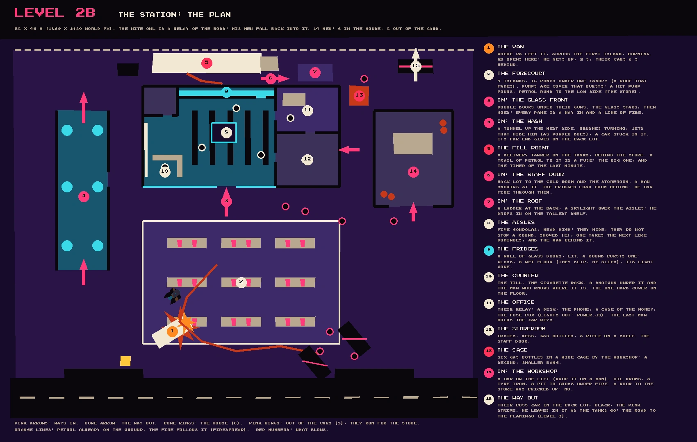

# LEVEL 2 - THE CHASE (2A) AND THE STATION (2B): level design and roadmap

This is THE reference for level 2. Read it before any level 2 work, keep to it, change it when a decision changes
(say so in the log), and add a line to the progress log at the end of every step (date, what was done, commit).
The concept boards are in docs/level2/ (painted by the concept pass of 2026-11-18, user-approved direction).

## Story and structure

- The night after level 1: the runner drives off in the boss's men's van (level 1's ending page); they come after
  him. CUEBALL's matchbook points to the FLAMINGO MOTEL, where JITTERS hides: that is LEVEL 3, not level 2.
- Level 2 is two levels (the user's call, CLAUDE.md Gameplay): **2A, the chase** (about 2 min 30, from the bar's
  district to a big roadside gas station, ending on the van crashing through its first pump) and **2B, the station**
  (on foot: the van burning on the forecourt, the boss's men falling back into the store). Dying in 2A restarts the
  chase from 0:00; dying in 2B restarts 2B at the crash (he gets up off the ground, as level 1's opening).
- One hit kills still holds in the van: a shot told and not dodged through his window, a nose-on hit on something
  that does not give, or being shoved off the road. Scrapes cost nothing (no health bar).

## 2A gameplay: proposal B, "shove and shoot" (chosen)

- **Driving.** He steers freely; the road pulls the van along it (a spring toward the road's line and heading, so
  letting go straightens it). Forward / back: throttle / brake around a cruise speed set by the segment.
- **The shove (SPACE).** A hard sideways jolt of the van toward the mouse's side, with a cooldown (a bar on the
  HUD). It is a real Matter impulse: what the van hits is pushed into the scenery (piers, lorries, parked cars, the
  rail, gates). The wrecks come from the physics, not from scripts.
- **Shooting.** Mouse aim, one hand, out of the DRIVER's window only (the van faces +x: the driver's side is -y);
  the pistol finishes what the shove started. Rounds are scarce: a killed gunman's gun or a magazine can fly into
  the van's lane as a pickup.
- **Killing a car.** Windscreen (the driver): it veers into the rail. A front tyre: it spins. The gunman: it goes on
  and can still ram. A hard enough shove into something solid: wrecked.
- **Telegraphs (readability first).** A gunman's shot: a white glint at the muzzle, then a thin red line that
  fattens into a wedge with a bracket where it lands (0.6 to 0.8 s), then the shot; the line locks onto a lane, not
  the van, so a lane change or a brake dodges it. One gunman tells at a time early on, two overlapping at the end.
  Obstacles about to enter the frame: red chevrons at the screen's edge. A safe gap: bone arrows. Nothing else red
  on the road.
- **Who is who.** The pursuers are the only black cars, with one pink stripe; civilians are pale or coloured.
  Enemy tracers bone, telegraph red, his own muzzle flash orange.
- **Slow motion** (from proposal C) only at three moments: the two jumps and the level crossing (time x0.25, weak
  points marked: a tyre, a tank, a driver).
- **Camera.** It pulls out with speed: about 360 world px high at 60 km/h, 400 at 90, 440 at 120, 480 on the jump
  (the normal view is 290); the van held in the left third so he sees far enough ahead.
- Rejected as the main mechanic: A (lane-snap shooting: readable but on rails, seven rounds his only violence) and
  C (autopilot shooting gallery: throws the physics away). Boards: [A](level2/gameplay_a.webp),
  [B sheet](level2/gameplay_b_sheet.webp), [C](level2/gameplay_c.webp).

## 2A route (2 min 30, a tick every 15 s)

The level is built as a STRAIGHTENED strip: the road runs along +x on screen (as systems/Traffic.js lanes already
do); the route map's bends are only suggested by the scenery. (Turning the camera with the road is not planned.)

| # | Time | Segment | Speed, camera | What it is |
|---|------|---------|---------------|------------|
| 1 | 0:00-0:25 | THE BACK ROAD | 60 km/h, 360 px | 2 lanes and a row of parked cars. Learns: steer, shove, shoot. One car, then two. Breaks: bins, hydrants, news boxes, parked cars, a terrace. |
| 2 | 0:25-0:36 | THE ON-RAMP, THE TOLL | 90 km/h, 400 px | The road opens to 4 gates. Decides a gate 1.5 s out. They follow or die. |
| 3 | 0:36-1:10 | THE MOTORWAY | 120 km/h, 440 px | 4 lanes one way, traffic, lorries. Three of them at once. Piers, lorries and the rail are his weapons. The tanker at 0:58. |
| 3b | 1:10-1:25 | THE INTERCHANGE: A CHOICE | 110 km/h, 480 px | A: the unfinished flyover (needs 110 km/h at the plate, 1.5 s in the air, slow motion, one free round, one of them falls). B: the underpass (piers, a lorry coming; nothing lost, nothing won). |
| 4 | 1:25-2:03 | OFF THE ROAD: THE STORM DRAIN | 100 km/h | Through the site fence and down: concrete, a thread of water, banks he can ride, dumped things, piers. A helicopter light: in it their shots are told faster. Out by a ramp: the second jump. |
| 5 | 2:03-2:30 | THE LAST ROAD | 110 km/h | 2 lanes, traffic both ways. The level crossing. The last car. A tyre goes at 2:20: on the rim to the station. |

Events:

| # | Time | Event | What happens |
|---|------|-------|--------------|
| 1 | 0:08 | OUT OF THE ALLEY | One of theirs across his nose: its lamps first, a red lane. Brake, or shove it into the parked cars. |
| 2 | 0:20 | THE LORRY BACKING OUT | It shuts the street. Under its tail, or up the kerb through a terrace: tables, chairs, an awning. |
| 3 | 0:30 | THE TOLL | Bone arrow: a wooden arm that flies. Red cross: steel. The one behind him takes the wrong one. |
| 4 | 0:46 | THEY MULTIPLY | Three cars, a gunman in each. Piers down the median, a lorry in the slow lane. |
| 5 | 0:58 | THE TANKER | It folds across three lanes, its petrol runs back down the road, the fire runs up it: 4 s. One gap. It goes up behind him. |
| 6 | 1:12 | FLYOVER OR UNDERPASS | The choice, told 3 s out by two signs: a bone arrow up, a bone arrow down. |
| 7 | 1:19 | THE JUMP | Cones and barriers fly. Time x0.25: a tyre, a tank, a driver marked. The slow one drops onto the motorway below. |
| 8 | 1:28 | THE BILLBOARD | Through the fence. Shoot its strut: it comes down across the way in, on whoever is behind. |
| 9 | 1:40 | THE DRAIN | Banks, water, carts and barrels. They come down the banks either side of him. |
| 10 | 1:52 | THE RAIL BRIDGE, THE LIGHT | Four piers in the bed, three ways through, told at the edge of the frame. A train over it. The helicopter light sweeps. |
| 11 | 2:03 | THE RAMP OUT | The second jump, through a chain fence, back onto a road. Slow again: one round. |
| 12 | 2:16 | THE LEVEL CROSSING | The barriers down, the train told by its lamp and a red band. Beat it: it cuts them off, or takes one. |
| 13 | 2:24 | THE TYRE | The last car: its gunman takes his rear tyre (always). On the rim, sparks, he steers the slide. |
| 14 | 2:30 | THE STATION | Through the first pump. END OF 2A. 2B opens on the van burning and him getting up. |

Segment boards: [1 back road](level2/s1_backroad.webp), [2 toll](level2/s2_toll.webp),
[3 tanker](level2/s5_tanker.webp), [3b jump](level2/s3_jump.webp), [4 drain](level2/s4_canal.webp),
[14 crash](level2/s6_crash.webp).

## 2B: the station

- 58 x 46 m. The forecourt: 9 islands, 18 pumps under one canopy (a roof that fades over him); pumps are cover that
  bursts: a hit pump pours, the petrol runs to the low side (the store); FireSpread runs it.
- THE NITE OWL store, a relay of the boss: his men fall back into it. Five gondolas head high (they hide, they do not
  stop a round; shoved, one takes the next like dominoes); a wall of lit drinks fridges (a round bursts one: glass,
  a wet floor, its light gone) with the cold room behind; the counter (till, cigarette rack, a shotgun under it); the
  office (desk, phone, a case of money, the fuse box: lights out, systems/Power.js; the last man holds the car keys);
  the storeroom (crates, kegs, gas bottles, a rifle on a shelf, the staff door); toilets.
- Ways in: the glass front under their guns (every pane a way in and a line of fire); the car wash tunnel (brushes
  turning, jets that hide him like the extinguisher powder); the staff door from the back lot (a man smoking at it);
  the roof (ladder at the back, a skylight over the aisles: he drops onto the tallest shelf); the workshop (a car on
  the lift to drop on a man, oil drums, a tyre iron, a pit).
- The back lot: a delivery tanker on the fill point (a petrol trail to it is a fuse: the big one, and the timer of
  the last minute); a cage of six gas bottles by the workshop (a second, smaller bang).
- 14 men: 6 in the house, 8 out of the cars. The way out: their boss car in the back lot (black, the pink stripe): he
  leaves in it as the tanks go; the road to the Flamingo (level 3).
- Boards: [opening, the restart point](level2/2b_opening.webp), [forecourt](level2/2b_forecourt.webp),
  [store](level2/2b_store.webp), [car wash and back lot](level2/2b_backlot.webp).

## Art

Comic paintings: [the jump](level2/art_jump.webp), [the tanker](level2/art_tanker.webp),
[the siege](level2/art_siege.webp), [the chase](level2/art_chase.webp), [the crash](level2/art_crash.webp),
[the station](level2/art_station.webp). Level 3 teasers: [the Flamingo](level2/l3_flamingo.webp),
[JITTERS](level2/l3_jitters.webp).

Sprites the boards painted that do not exist yet: the pursuers' black car with its pink stripe (a car / car2
variant), civilian car palettes, lorry cab with tank and box trailers, toll booth and gates, cones, barriers, piers,
the billboard, pumps, islands, canopy, store shelves, fridge wall, counter and cigarette rack, glass front, car wash
brushes.

## Architecture decisions

- **A long straightened level.** 2A is a level like the others (tools/build_level2a.py through levelkit), very long
  along x. The whole route is about 2.4 km (2400 tiles): rendering and every map-sized buffer must be CHUNKED (baked
  near the camera, dropped far from it); level 1's map is 42 x 38 tiles, a back road alone is about 420 x 24.
  Segments may become separate builders joined end to end.
- **Drive mode.** The player sits in the van (hidden, carried with it); the van is a DYNAMIC Matter body driven by
  forces (not Vehicle.driveTo, which teleports and collides with nothing), so the shove and every impact are real.
  Its logic is DOM-free with its numbers in data/ (a `CHASE` table), unit tested.
- **Pursuers.** Vehicles with an AI (follow, flank, ram) and a gunman who leans out and tells his shot; their kill
  rules (driver, tyre, gunman, impact).
- **Events.** A level-data schedule by distance along the road (x), not by time, so a slow driver meets them in the
  same places; each event a small DOM-free system.
- **Lab.** Every new mechanic gets its station (the shove, a pursuer, the telegraph, later the jump).

## Roadmap

Milestones in order; each ends merged into main with its tests, a QA or shot check and a line in the log.

- [ ] **M1a - The back road, drivable.** Chunked rendering for long maps; tools/build_level2a.py with segment 1
  (the back road: 2 lanes, a parking row, kerbs, shopfronts, alleys, street furniture that breaks); drive mode
  (steer, throttle, brake, the road's pull), the shove, nose-on crash death, the camera's pull-out and lead; the
  level reachable with ?level=level2a; a lab station; placeholder end (reaching the road's end ends the level).
- [ ] **M1b - The first pursuers.** The pursuers' car sprite; pursuer AI (follow, flank, ram); the gunman and his
  told shot (glint, red line, bracket); shooting out of the driver's window (arc, ammo, pickups); kill rules; event
  1 (out of the alley) and two cars by 0:25; HUD (speed, shove bar, distance).
- [ ] **M1c - Back road polish.** Event 2 (the lorry backing out, the terrace); what breaks on the kerb; sounds as
  named placeholders; tuning in play; first playable demo of 2A's first 25 s.
- [ ] **M2 - The toll and the motorway.** On-ramp, toll gates, 4 lanes, traffic, lorries, piers, three pursuers, the
  tanker.
- [ ] **M3 - The interchange.** The choice, the flyover jump (airborne state, slow motion, weak points), the underpass.
- [ ] **M4 - The storm drain.** Off-road surfaces, banks, the billboard, the rail bridge, the helicopter light, the
  second jump.
- [ ] **M5 - The last road and the crash.** The level crossing, the forced tyre, the crash into the station, 2A's end.
- [ ] **M6 - 2B, the station.** The level from the plan, its new props and systems, the store, the finale.
- [ ] **M7 - Comic pages** for 2A / 2B (opening, ending), sounds, QA plans, balance.

## Progress log

- 2026-11-18: concept pass done (gameplay proposals A/B/C, route, segment boards, 2B plan, paintings); the user
  chose B, the 2A / 2B split with 2B restarting at the crash, the Flamingo as level 3, and started M1 with the
  back road. This document written.
