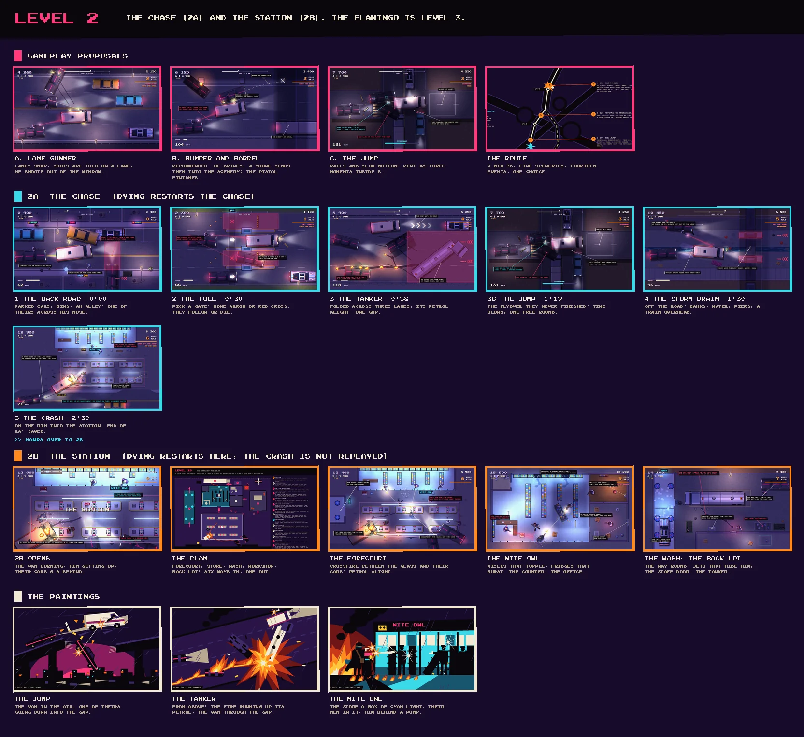
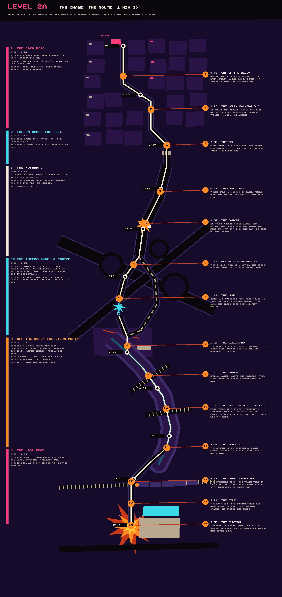

# LEVEL 2 - THE CHASE (2A) AND THE STATION (2B): level design and roadmap

This is THE reference for level 2. Read it before any level 2 work, keep to it, change it when a decision changes
(say so in the log), and add a line to the progress log at the end of every step (date, what was done, commit).
The concept boards are in docs/level2/ (painted by the concept pass of 2026-11-18, user-approved direction).

## Story and structure

- The night after level 1: the runner drives off in THE BOSS'S OWN CONVERTIBLE (level 1's ending page): bone body,
  blood-red seats, chrome, roof down, the boss's hat on the rear seat; the boss's men come after him. CUEBALL's matchbook points to the FLAMINGO MOTEL, where JITTERS hides: that is LEVEL 3, not level 2.
- Level 2 is two levels (the user's call, CLAUDE.md Gameplay): **2A, the chase** (about 2 min 30, from the bar's
  district to a big roadside gas station, ending on the convertible crashing through its first pump) and **2B, the station**
  (on foot: the car burning on the forecourt, the boss's men falling back into the store). Dying in 2A restarts the
  chase at the last CHECKPOINT reached (the user's call, 2026-11-20: "comme il est special, on peut mettre des
  checkpoints", the one exception to the no-checkpoint rule with the tutorial's rooms): one a part of the road as it
  was cut (the level's `chase.checkpoints`, systems/Checkpoints.js): TWO, as the user cut it (2026-11-20: "2 checkpoints comme
  on a decoupe le niveau"): THE STREET (the start) and THE ON-RAMP (col 462, leg 1 just out of the detour's turns:
  part 2 from the detour to the toll); each part to come adds its own. Reached, its name
  is stamped under the road's bar a moment (CHECKPOINT, CHASE.checkpoint; placeholder sound `checkpoint`). A death
  after it (R, the pad's A, a click, RETRY in the death screen's pause: Game.retry) reloads the level and starts the
  car there, on its leg's lane (ours), at its cruise already rolling, the Uzi in hand, no cigarette nor grab, the
  part's name on the level's card; the events behind it are not replayed, those ahead are armed as from a start
  there, the props are the level's. The clock and the score are those it had when he reached it (a death costs the
  part, not the run's time so far); a run through checkpoints is ranked like any (its time is the whole run's). RESTART
  in the pause, Backspace and a start from the menus or the LEVELS page start from 0:00. Dying in 2B restarts 2B at
  the crash (he gets up off the ground, as level 1's opening).
- One hit kills still holds in the car: a shot told and not dodged into the open cabin, a nose-on hit on something
  that does not give, or being shoved off the road. Scrapes cost nothing (no health bar: his car is never shot up,
  burnt or blown); a corner clipped (what he hit covering under a fifth of his nose) is a jolt that takes his speed,
  not his life.

## 2A gameplay: proposal B, "shove and shoot" (chosen)

- **The car.** The boss's convertible, roof down: the runner is SEEN at the wheel (cap, collar, the coat's tails
  flapping out over the door), so one hit kills reads at a glance; about 2.1 t of land yacht with chrome bumpers
  for the shove. Boards painted before this choice still show a van.
- **Driving** (reworked 2026-11-19, the user: "accelerating / braking is useless"). NO throttle, NO brake: the car
  runs at the segment's cruise speed by itself; only what it hits slows it, and it comes back up alone. He steers
  across the road, which is up / down on the picture: W (Z) / S, or A / D, or the pad's left stick; letting go
  straightens it (the road's pull). The nose turns a few degrees at most (`heading` 0.2 rad, a spring that does not
  wag); the body still moves on its wheels (sat back as it pulls away, the nose down on a hit, rolled out of a
  bend, thrown up by a kerb, a hit, the road). THE SLIDE (2026-11-19, the user: "plus realiste dans les virages"):
  the rear steps out, up to 0.34 rad, on a flick (the wheel thrown over while the car still goes the other way), on
  full lock held 0.4 s, on a shove, on a pursuer's swipe or a parked car grazed; countersteer catches it at once,
  nothing held it fishtails once; past 7 degrees it scrubs up to 30 % of the speed, its rear tyres smoke and leave
  rubber (CHASE.slide, Drive slideStep / gripOf; the pursuers slide by the same rule).
- **The shove (SPACE / pad A): THE move.** A lunge of one lane (about 95 px in 0.3 s) toward the side he aims at,
  every 0.7 s (a bar on the HUD). On a pursuer it is a real blow: half its hp, thrown half a lane and more out of
  its driver's hands, its gunman's shot off; TWO wreck it in the open, ONE that throws it into something solid (the
  parked cars, a pole, a tree, the bus shelter, a wall) does. Into nothing it lands him in the next lane: it is his
  dodge too.
- **A parked car is never a wall** (2026-11-19, the user: "elle doit se mettre sur le cote, la elle nous bloque").
  What he hits of the parked rows (or a wreck left on the road) is SHOVED ASIDE by hand (Drive.aside, CHASE.aside):
  thrown on ahead of him and out to its side, turning, its alarm going, sparks, its glass on a square hit; he loses
  10 % of his speed on a graze, up to 50 % full on the nose (never under 35 % of cruise: never stopped, never
  stalled), and NEVER dies of it. A shoved car stays where it lands: it may lie in a lane, a new obstacle the
  pursuers go round too, but never across both (Drive.clearLanes pushes it on to its kerb). A pursuer that runs
  into one at speed is still wrecked on it.
- **The pursuers come ALONGSIDE** (reworked 2026-11-19: they sat behind him, out of his arc). No slot is behind him:
  abreast in the lane he is not in, a length ahead in that lane, ahead in his own lane (shot over the windscreen);
  a fourth further ahead. One joining from behind starts just off the picture and is in his arc in about a second.
  Which slots are held changes every 4 to 7 s; the rearmost car takes the rearmost slot (nobody passes anybody);
  when he changes lanes the one abreast comes round his nose to his other side, never through him. Each gunman
  leans out on his side (from the car ahead: back along its flank).
- **They take turns attacking** (2026-11-19, the user: "fluide et vraiment plaisant"): ONE attack at a time, 1.1 to
  1.8 s apart, in a round (a told shot, a ram, a told shot, a brake; the kind due skipped only when nobody can make
  it), each TOLD. THE RAM, from abreast: 0.5 s of wind-up (its lamps flash, it draws away from him leaning out),
  then the swipe at his flank (a jolt, his tail kicked out, never his death); a lane change dodges it, a shove INTO
  it during the wind-up lands first. THE BRAKE, from ahead in his lane: its brake lights 0.45 s, then it runs 3.2
  px/step slower than he was going as it was told, for 0.9 s: onto his nose unless he changes lanes (a jolt that
  takes his speed; it no longer follows his speed down after each knock, which brought both cars to a crawl). Hurt by a shove (not wrecked), a car
  keeps its distance 2.5 s (the far slot), smoking. Each car has a STYLE set by its event: `gunner` (tells shots,
  rams when nobody else does), `rammer` (never tells, alone it sits abreast), `blocker` (alone it sits ahead of
  him). The wheel of each follows a line that slides (300 px/s), no jump from one line to the next.
- **Shooting.** Mouse aim, one hand, from the open car (it faces +x; the driver sits on the -y side): ALL ROUND
  but behind him (the user's call, 2026-11-18): 125 degrees either side of the nose, 250 in all: out of his door,
  ahead OVER the low windscreen, across the passenger seat to his right (the gun goes over to his right hand, the
  left takes the wheel), back along both flanks; only the 110 degrees behind him stay out. The Uzi finishes what the
  shove started. At the wheel it NEVER RUNS DRY (the user's call, 2026-11-19): no count, no reload, no pickups.
- **The gun: THE BOSS's Uzi, off his passenger seat** (the user's call, 2026-11-18). It lies on the convertible's
  passenger cushion (Vehicle `gun`; in level 1 too, seen as he vaults in and drives off, never a pickup there). 2A
  opens on a short beat, the first time only (a retry starts with it in hand, like level 1's bottle): the car rolls
  on by itself, the camera pushed in on him; his head turns to the seat, the right hand leaves the wheel and he leans
  over for it, brings it up across his chest, the left hand comes off the door and racks it, then it goes into the
  left hand and hangs out over the door, the right hand back on the wheel (about 1.7 s; systems/Drive.js grab,
  CharacterAnim grabPose, SEAT.grab in data/feel.js, SHOTS `grab` / `grabOut`). Nothing is told before it is done.
  Driving, the Uzi hangs over the door in his left hand; aimed out of his side that arm lifts it (`chase.arms`: 30
  in it for when he gets out; nothing is counted at the wheel).
- **Killing a car.** A burst at the windscreen (the driver; one stray round only stars it): the quick way. A front
  tyre: it spins. The gunman: it goes on and can still ram. A long burst on its body (about 65 Uzi rounds, 2.4 times
  what it took before: the user, 2026-11-19, "tirer plus pour la peter") wrecks it in stages: the rear glass cracks
  then goes, the engine smokes, catches fire, dies. A hard enough shove into something solid: wrecked. Whatever
  stops it, THE EXIT takes over (2026-11-19, the user: a destroyed car must not be run into nor slow him): it swerves
  away from him, brakes, skids into what lines the road on that side and is left behind, off the picture; it blows
  up there, never by his car.
- **Telegraphs (readability first).** A gunman's shot: a white glint at the muzzle, then a thin red line that
  fattens into a wedge with a bracket where it lands (0.6 to 0.8 s), then the shot; the line locks onto a lane, not
  the car, so a lane change or a shove dodges it (a shove INTO the car that tells cancels its shot). One gunman tells at a time early on, two overlapping at the end.
  Obstacles about to enter the frame: red chevrons at the screen's edge. A safe gap: bone arrows. Nothing else red
  on the road. A ram is told by the car itself (lamps flashing, drawn away), a brake by its brake lights.
- **Who is who.** The pursuers are the only black cars, with one pink stripe; civilians are pale or coloured.
  Enemy tracers bone, telegraph red, his own muzzle flash orange.
- **Slow motion** (from proposal C) at three moments of the route: the two jumps and the level crossing (time
  x0.25, weak points marked: a tyre, a tank, a driver). And, the user's call (2026-11-19, "un cote film d'action"),
  the chase's own beats (systems/ChaseCam.js, CHASE.cinema): a pursuer stopped for good (strong the first time and
  once its 7 s cooldown is over, a tick otherwise, never strong twice in a row) and the lorry across his road (on a
  collision course, 0.8 s from it: x0.3 until he is clear of it, the wheel handed more). Nothing else slows the chase.
- **Camera** (reworked 2026-11-19: the car was STILL blurred). At the wheel the picture is drawn 1:1: the scene's
  canvas is the window and the zoom the whole one nearest to 360 world px of view (3 at 1080 and at 900, 4 at 1440,
  6 at 2160: 300 to 430 px of view; level `chase.view`; engine/Camera.js fitView), the lens scales nothing (no
  barrel, no scan lines, no zoom kick, its fringe kept to the edges). The camera is held on whole px (`pixel`: no
  tilt, no turn even shaken, no lag) and LOCKED on the car: a third of the view from the left, the street's middle
  across (`chase.mid`), so the car never slides on the picture. A driven car is drawn at a whole px, on one of 64
  angles kept with 1.5 degrees of slack (Vehicle.pose, CHASE.pixel): a lane change shows two of them. In and out of
  a car the view changes in one cut. To be 400 at 90, 440 at 120, 480 on the jump (as whole zooms allow).
- **Speed.** NO SPEEDOMETER (the user's call, 2026-11-19): the speed is felt. What sells it, none of it moving a px
  of the picture (2026-11-19, the user: "les voitures se deforment dans les extremites de l'ecran": the lens' trails,
  stretch and parted colours are gone at the wheel, render/Lens.js driveLens): in the outer band the lens only ADDS
  streaks of air and dims the band (a shove or a hit deepens it); in the world twice the streaks of air (38, up to
  64 px long, from 34 km/h), more dust off the rear wheels, paper and leaves whipped up in its wake every 0.16 to
  0.5 s, the shell shivering on its wheels at cruise, the car coming forward on the picture when a hit takes a fifth
  of its speed and falling back as it picks up (whole px), and a road that shows it goes by: the centre line and
  the parking row's edge line are DASHES (2 m and 3 m), the parked rows thinner so each car flicks by alone.
- Rejected as the main mechanic: A (lane-snap shooting: readable but on rails, seven rounds his only violence) and
  C (autopilot shooting gallery: throws the physics away). Boards: [A](level2/gameplay_a.webp),
  [B sheet](level2/gameplay_b_sheet.webp), [C](level2/gameplay_c.webp).

## 2A route (2 min 30, a tick every 15 s)

The level is built as STRAIGHTENED strips: each leg of the road runs along +x on screen (as systems/Traffic.js lanes
already do); a real corner between two legs is a SCRIPTED BEND (see "Legs and scripted bends" below), the camera
never turned. The route map's other bends are only suggested by the scenery.

| # | Time | Segment | Speed, camera | What it is |
|---|------|---------|---------------|------------|
| 1 | 0:00-0:25 | THE BACK ROAD | 60 km/h, 380 px | A street of twelve sections (the table below): 2 lanes (2.5 m) nothing stands in, parking on the north side, on ours or on neither; shops, a junction under traffic lights, a railway bridge, a dark stretch with a vacant lot and works in its parking row, a bus stop, houses behind their front yards, the lorry's yard and the fruit market, the diner on the lit corner, a second junction, the freeway's sign: a GRADIENT from level 1's suburb to Miami. Learns: steer, shove, shoot. One car, then one more at a time (four on him at the most). Breaks: hydrants, signs, meters, news boxes, benches, trees and palms, a bus shelter, traffic lights, parked cars, the fence, garden walls, a fruit market. |
| 2 | 0:25-0:36 | THE ON-RAMP, THE TOLL | 90 km/h, 400 px | The road opens to 4 gates. Decides a gate 1.5 s out. They follow or die. |
| 3 | 0:36-1:10 | THE MOTORWAY | 120 km/h, 440 px | 4 lanes one way, traffic, lorries. Three of them at once. Piers, lorries and the rail are his weapons. The tanker at 0:58. |
| 3b | 1:10-1:25 | THE INTERCHANGE: A CHOICE | 110 km/h, 480 px | A: the unfinished flyover (needs 110 km/h at the plate, 1.5 s in the air, slow motion, one free round, one of them falls). B: the underpass (piers, a lorry coming; nothing lost, nothing won). |
| 4 | 1:25-2:03 | OFF THE ROAD: THE STORM DRAIN | 100 km/h | Through the site fence and down: concrete, a thread of water, banks he can ride, dumped things, piers. A helicopter light: in it their shots are told faster. Out by a ramp: the second jump. |
| 5 | 2:03-2:30 | THE LAST ROAD | 110 km/h | 2 lanes, traffic both ways. The level crossing. The last car. A tyre goes at 2:20: on the rim to the station. |

Events:

| # | Time | Event | What happens |
|---|------|-------|--------------|
| 1 | 0:06 | OUT OF THE ALLEY | One of theirs out ahead of him: its lamps first, a red lane where it crosses, into the far lane (told early: there is no brake). Keep out of that lane; then it is alongside: shove it into the parked cars. |
| 2 | 0:20 | THE LORRY BACKING OUT | Told 0.9 s (its beeper and reversing lamps, red chevrons on the edge of the screen, a red lane, bone arrows on the way round), then it shuts the street in 1.4 s. No brake, no way under its tail: up the kerb through THE FRUIT MARKET (the wheel, or a shove): stalls under their striped awnings, crates of oranges, mangos and coconuts, MANGOS signs, the fruit all over the road. Whoever follows him into it dies there. |
| 3 | 0:30 | THE TOLL | Four lanes under a lit roof, a gate at the end of each: a wooden arm (a green arrow over its lane) flies off in its lengths at a tenth of his speed; a steel boom (a red X) is the crash. His own lane is steel: he steers, told 1.5 s out (bone arrows down the wooden lanes, each lane's own signal big over its mouth: a green arrow, a red X; the same on the screen's right edge while its mouth is off the picture), and THE CHOOSING (2026-11-20, the user: "un petit ralenti comme au camion"): 1.3 s out the world slows to x0.3, the view cuts out a whole zoom (2 px a world px at 1080) to frame the gates, the arrows pop, the wheel answers in real time and 1.45 x further, until he is on a wooden lane's line in the fan (or 0.45 s before the mouths, or 2.8 s), then one cut back. The one behind him takes the wrong one: THE CRASH on its boom (thrown back spinning, its nose folded, its lamps and windscreen gone, the boom bent, the biggest fire-ball of the chase, the roof seen through, the kill's own beat: x0.2, the view cut out and drawn back to it); another follows him through an arm. An arm bursts in splinters and paint chips with a crack, the attendant over that lane ducks; a breath of slow motion through his. (The section table below.) |
| 4 | 0:46 | THEY MULTIPLY | Three cars, a gunman in each. Piers down the median, a lorry in the slow lane. |
| 5 | 0:58 | THE TANKER | It folds across three lanes, its petrol runs back down the road, the fire runs up it: 4 s. One gap. It goes up behind him. |
| 6 | 1:12 | FLYOVER OR UNDERPASS | The choice, told 3 s out by two signs: a bone arrow up, a bone arrow down. |
| 7 | 1:19 | THE JUMP | Cones and barriers fly. Time x0.25: a tyre, a tank, a driver marked. The slow one drops onto the motorway below. |
| 8 | 1:28 | THE BILLBOARD | Through the fence. Shoot its strut: it comes down across the way in, on whoever is behind. |
| 9 | 1:40 | THE DRAIN | Banks, water, carts and barrels. They come down the banks either side of him. |
| 10 | 1:52 | THE RAIL BRIDGE, THE LIGHT | Four piers in the bed, three ways through, told at the edge of the frame. A train over it. The helicopter light sweeps. |
| 11 | 2:03 | THE RAMP OUT | The second jump, through a chain fence, back onto a road. Slow again: one round. |
| 12 | 2:16 | THE LEVEL CROSSING | The barriers down, the train told by its lamp and a red band. Beat it: it cuts them off, or takes one. |
| 13 | 2:24 | THE TYRE | The last car: its gunman takes his rear tyre (always). On the rim, sparks, he steers the slide. |
| 14 | 2:30 | THE STATION | Through the first pump. END OF 2A. 2B opens on the car burning and him getting up. |

### Segment 1, section by section (the street rebuilt, 2026-11-19)

The user threw the first road out ("a real road, realistic and varied, every stretch built precisely"). The back road
is now a street of Sunset Bay built as one is (tools/build_level2a.py). The two lanes never move and NOTHING stands in
them (theirs, westbound, on row 12.25; ours on 14.75): what changes is what lies either side. Three cross-sections:
**A** parking on the NORTH side (sidewalk 1 m, parking row, lanes, sidewalk 2 m), **B** parking on OUR side (north
sidewalk 3 m with trees, lanes, parking row, sidewalk 1 m, the south fronts a row back), **C** no parking (north
sidewalk 3 m, lanes, south sidewalk 2 m). The events keep their columns.

| Cols | Section | North side | South side (ours) | Parked cars | What happens | MIAMI (0 level 1's suburb .. 5 Sunset Bay) |
|------|---------|------------|-------------------|-------------|--------------|------|
| 0-45 | A THE SHOPS | LIQUOR, BAR, VIDEO, WASH 24H, meters on a narrow sidewalk | shops, benches, a speed sign | north, from col 14: 3 | The start (col 8.5), the Uzi taken; the lights ahead go amber. Lane arrow, the centre line double from col 28 to the stop line. | 0: level 1's district as it was: brick, the shops' neon, no palm |
| 46-61 | J CORAL STREET | corners rounded out to the lane, hydrant (red kerb), mailbox | news boxes, a bin | none | Traffic lights on mast arms (ours over our lane, red as he reaches it: he runs it), crossings on all four arms, stop lines, one-way street south with two cars waiting at their red. | 0 |
| 62-104 | B | 3 m sidewalk: trees and palms in grates, benches, a passage (cols 99-100) people use | parking row, meters behind it; two bays hatched LOADING (yellow kerb) | south, cols 64-88: 2 | First pursuer alongside. The fronts of our side are a row back: shoving one into the parked cars is on OUR side here. | 1: the first cabbage palms (sabal) take the place of two of the four street trees, a fallen frond; a BAIL BONDS bus bench; PALM PLAZA, the strip's pole sign, at the wide north sidewalk's end (col 102) |
| 105-147 | A | shops, hydrant at 107 (red kerb) | shops; alleys at 105 and 138 | north, cols 110-146: 2 | Event 1: the car out of the alley at col 138 (told at 111), into the far lane. SLOW painted at 143. | 1: PALM PLAZA's pole sign (LIQUOR, PAWN, CHECKS CASHED, BODEGA) just before it, north; yellow and red news boxes; a ragged sabal; a camp in the strip's blind doorway (nobody home), HUNGRY GOD BLESS on cardboard |
| 148-156 | THE RAILWAY BRIDGE | abutment, the track on it | abutment | none (red kerb, no-parking sign) | A single-track bridge over the street: it fades over him as he passes under, its shadow on the road. Pigeons. | 1: a bedroll and bottles left under it |
| 157-246 | A THE DARK STRETCH | the vacant lot behind its chain fence (cols 160-226), a gap cut in it | blind walls, pipes, bin bags; alleys at 190 and 232 | north, few (cols 158-200, 234-240): 2 | A lamp every 14 m on alternate sides (to col 220), each failing its own way (stutter, broken, dying). The gas works in the parking row (cols 203-231): trench, spoil, steel plate, compressor, barricades with flashers, cones along the lane's edge, an arrow board and a sign for who comes down their lane. The lane itself stays whole. Second and third pursuers from behind (cols 165, 250). | 1, derelict: a palm's stump, sabals gone wild in the lot and a coconut palm leaning out of it over the fence, fronds and coconuts on the sidewalk; a man asleep on his cardboard by his bags, another smoking by his loaded cart; a dumped mattress and pallets in the lot. No keg, no drum |
| 247-271 | C THE BUS STOP | 3 m sidewalk: the shelter (lit advertising case), its sign, a bench, red kerb, BUS STOP on their lane | shops | none | Double centre line. | 2: an ABOGADO bus bench (a man sat on it), a pastel pay phone (a man at it), somebody waiting for the night bus, young palms in grates; the first pastel fronts (peach north, mint south) |
| 272-312 | B | the houses' front yards (2 m) and a sidewalk of 1 m | alley at 272; parking row cols 278-309 | south: 2 | The lorry is told at col 303. | 2: HOUSES north (cols 277-311): stucco in peach, mint, pink and lilac, each behind a front yard two metres deep (the wide sidewalk's rows 8-9 in grass, a sidewalk of 1 m left): low garden walls or a chain-link fence, oleanders, lawn flamingos, a mailbox on its post at each path, porch lights, sabals in the yards, a coconut palm leaning out over the sidewalk |
| 313-356 | A (nobody parked) | blind wall; THE YARD's gate (cols 337-342): dropped kerb, a hatched box, yellow kerbs, no-parking signs | 3 m sidewalk, then THE FRUIT MARKET (cols 325-354): the fronts set back four metres, the sidewalk's row along the kerb then beaten earth, two rows of stalls, crates and signs by the kerb | none | Event 2: KEEP CLEAR on both lanes, the lorry backs out across them; the market is the way round. | 3: THE FRUIT MARKET on the vacant corner (nine stalls each under its bulb, strings of bulbs along its front, crates, MANGOS FRESH 3/$1, a sabal, a leaning coconut palm, the man who keeps it, a customer); peach, mint and pink fronts north, pastel awnings from here on |
| 357-388 | A THE LIT CORNER | shops | the diner: glass, booths, phone booth, news boxes, benches | north, cols 358-382: 1 | The last car is set off (col 368). | 4: a pink deco canopy over the diner's door, its piers in pink stucco, young palms in grates along its kerb; mint and peach fronts north, a flamingo in neon, a pink tube |
| 389-403 | J THE CROSS STREET | corners rounded, hydrant, mailbox | news boxes | none | Lights on all four corners (ours red, the cross street's green: the last pursuer comes out of it on HIS green). | 4: the news boxes yellow, blue and red, a blue mailbox |
| 404-445 | C TO THE FREEWAY | 3 m sidewalk, royal palms in grates, hibiscus; DETOUR (col 424) | shops; DETOUR (cols 431, 438) | none | Lane arrows, the freeway's sign over the road (FREEWAY, TOLL 1 MILE); the yellow DETOUR arrow painted twice in our lane (cols 424, 433: on, then right). The script takes the wheel at col 438 (part two below). | 5: every front in stucco (pink, mint, lilac, peach), ROYAL PALMS in their grates lit from their feet (cyan and pink in turn, as the ramp's), hibiscus hedges, deco canopies over the doors, a pink tube, young palms south, puddles with the neon in them, a BAIL BONDS bench: the alley's stucco and the ramp follow |

Parked cars: 12 in all (thinned from 21 on 2026-11-19, the user: "trop de voitures sur les cotes"; the count by
section is in the table, asserted by the builder and tests/road.test.mjs). The bays left empty show an old patch or
a sealed crack, two of them a cone; three cars are parked badly (astride two bays, two wheels up on the kerb), never
askew (a corner would be in the lane).

THE GRADIENT (2026-11-20, the user: "le debut est raccord avec le suburb du niveau 1, mais la transition est trop
brutale ... on s'approche de Miami mais on reste encore un peu en banlieue"): the table's last column. It is laid by
THE HARMONY PASS of tools/build_level2a.py, after the street's dice are all thrown (nothing of it draws from them:
the parked cars, the shops and the roofs stay put): things taken away or swapped by hand (`drop`, `swap`), fronts
painted (`stucco`: the wall tiles P / M / Y / V), new things each at its place. What grows along it: palms (none,
then sabals, young palms in grates, coconut palms, royal palms at the end: 2 street trees and about 30 palms where
there were 8 trees and 5 palms), pastel stucco (none before col 247, every front past col 400), pastel awnings (one
in two from the bus stop, all from the market on), neon and deco (the canopies, the tubes, the flamingo, the palms
lit from their feet). What recurs from the street to the toll: the bus benches with their ads (BAIL BONDS, ABOGADO),
the yellow and red news boxes, fallen fronds and bottles, the homeless (a camp, a sleeper, a cart on the street; the
camp under the freeway's bridge has the same cart and cardboard). THE LORRY'S DODGE: of the three sets painted for
it (a fruit market, a car wash, a tyre yard) the FRUIT MARKET: lit stalls and bright fruit read at night and from
the wheel, its signs are the street's Spanglish, and all of it is torn or flung (the tyre yard is black rubber on a
dark lot, round things by a road again; the car wash has too little to send flying); the terrace's geometry kept.
NO KEGS (the user: "enleve les futs de biere qui trainent au milieu de la route"): the dark stretch's sidewalk had
two (62 kg, loose: hit on the kerb they were flung into the lanes ahead and lay there), and every crash cushion was
three or six sand barrels, round drums in the middle of the plaza's road before each island: the kegs are gone, the
loose drum by leg 1's dock too, and the cushions are repainted as what they are (a steel-framed attenuator: yellow
cartridges between fender rails, a chevron nose; tools/generate_assets.py p_crash_cushion).

Street furniture follows a street's rules (the builder asserts them): lamps every 24 m on alternate sides; meters
only at a bay; hydrants and red kerbs at corners; loose things (bins, boards, boxes) against the walls, never by the
kerb; kerbs along every sidewalk edge, dropped at alleys, gates and crossings; drains in the gutters. A car steered
at a side street is held on the line of the fronts (`chase.across`), and where the fronts step in toward the road
(a block set forward, the end of the terrace) the car is brought back inside their line before the corner
(CHASE.frontAhead): neither is a death nobody told.

### Segment 1, part two: the works, the detour, the on-ramp (2026-11-20)

Built on in the same builder, after the street (its own section of tools/build_level2a.py, "PART TWO"; no dice: the
street is the same one). Works shut the street past a side street; the script (the level's `bends`) takes him right
down it, under the freeway's bridge at its foot, and left onto LEG 1: a frontage road one way east at the foot of the
freeway's bank, which leaves its sheds for an embankment of its own as the on-ramp and meets the freeway's lanes
before the toll (col 560 on). Leg 1's lanes stay on rows 44.25 / 46.75 (both ours: one way), the lane line on 45.5;
its cross-section (rows): the freeway's asphalt 34-40 (two lanes of 2.5 m, its edge lines on 35.5 and 40.5, a
guardrail on 41.15), its bank in grass 41-42, the road 43-47, then the south sidewalk 48-49 and the sheds' fronts on
row 50, or (the ramp) a paved shoulder 48, the guardrail on 49.15 and the ramp's own bank. Framed from the freeway's
near lane to the sheds' fronts (`mid` 44.5). Cruise 70 km/h (10.4 px/step): a leg has ONE cruise (systems/Route.js,
Drive picks it up when the leg changes; nothing ramps within a leg), so the street's 60 rises to 70 out of the bend
and the toll's leg takes it on; the pursuers' top speed (14.5 px/step, 98 km/h) leaves them room at 70, little at 90.
The wheel is held (leg 1's `across`) between the bank and the sheds' fronts, off the cold store's dock edges and
inside the ramp's guardrail: what never gives is never nose-on.

| Cols | Section | North side | South side (ours) | What happens |
|------|---------|------------|-------------------|--------------|
| 446-473 | THE WORKS (the street) | the tyre shop's two shutters down (kerbs dropped), a lighting tower on each sidewalk end, the site fenced along both kerbs | the side street's mouth (corners rounded 1.5 m), the sidewalk shut by a barricade, a lighting tower | Six cones taper both lanes from the north kerb into the side street's mouth; an arrow board (its arrows down the side street), ROAD CLOSED with its two flashers, three water barriers, the road cut across both lanes (a fresh trench patch, the gas main's marks), a steel plate, the excavator on the milled band (its bucket at the barriers) and the dump truck waiting to be loaded (both seen from the turn, which sees no further), sand and asphalt heaps, jersey barriers at the far end. |
| 440-451 (rows 16-20) | THE SIDE STREET'S MOUTH | (west) the bar's block, its corner in pink stucco | (east) a sidewalk flared out (the tail swings there), OPEN 24 lit on it, a palm's fronds over the wall | The first turn; a sodium lamp. The first crates at its end are THE SMASH's slow motion. |
| 444-448 (rows 18-42) | THE ALLEY | (west, col 443) pink stucco (P): the bar's back door (its reveal in the stucco), COCKTAILS in violet neon, a pink tube, an AC dripping, two stucco trims, a fire escape, the bridge's abutment (graffiti in neon paint) | (east, col 449) mint stucco (M): the botanica's back door (likewise), its cyan sign and tube, an AC dripping, THE PARKED CAR against it (rows 29-33), the abutment (graffiti) | Five metres between walls, the bend's line down its middle (col 446.5): what he ploughs through at 40-50 km/h (CHASE.bend.smash), in order: produce crates (the slow motion, x0.35 for 0.6 s), boxes, a bin, bags, two lines of washing across (torn down, the cloth flies), a fruit cart (fruit everywhere), a news rack (papers), the old men's domino table (they dive away), a scooter, a lit box sign, bottles, THE PARKED CAR scraped its whole length (sparks off both, a mirror off, dents, its alarm and hazards), a hydrant under the bridge (its geyser and mist in violet light), a wheeled dumpster clipped (it spins away), crates. The first pursuer to follow him scrapes the parked car too and is wrecked on it (`snare`, the kill beat); the others plough on past its wreck. |
| 437-455 (rows 33.5-41.5) | THE FREEWAY'S BRIDGE | the deck over the alley (prop `overpass`, hung: it fades over him; its shadow painted under it), its abutments the alley's walls (plaster `#`) | | The second turn starts as he comes out from under it, out of the alley across the bank. |
| 424-451 (leg 1) | THE T | the freeway's bank, the alley's foot | the body shop's two shutters, the warehouse opposite (ONE WAY east on its post across from the alley, a sodium lamp lighting the T), a hydrant | He turns left out of it; the bend hands him to leg 1 in his lane at col 460.5. |
| 452-497 | THE FRONTAGE ROAD | the freeway up on its bank (its near lane, its guardrail, a kerb under the grass, the yellow edge line), a freeway lamp (col 470) with an arm over each road; on the bank, SUNSET BAY 1985: a camp out from under the bridge (cols 452-462: a blue tarp, a mattress with a tramp asleep on it, a fire in a drum with a tramp warming his hands, a shopping cart, litter), a chain-link fence along the bank's foot with a hole cut in it (col 468), royal palms (468, 493.6), the COCOA GOLD sun-tan billboard on its catwalk lit by four lamps (cols 473-481), a burnt-out car that came off the freeway through its rail (the rail dented at 481, a gap to 491) | the cold store's two loading docks (the kerb dropped along them, pallets, a drum) and a mint deco canopy over its office door (col 464), a royal palm in a grate (467), the yard gate (col 468); THE MOTEL's back (472-486, pink stucco): its MOTEL / VACANCY pole sign, MOTEL, a flamingo and VACANCY in neon on its wall, a pink deco canopy over its back door (480), hibiscus red and pink; THE USED CAR LOT (486-494): AUTO SALES on its pole, an 80s coupe up on its display ramp on the apron, two light poles with pennants strung between them; three sodium lamps (445, 458.5, 482.5); FREEWAY ENTRANCE at the lot's corner (col 495) | Lane arrows at col 462, white dashes 3 m every 9 m (in step with the toll's, unbroken to it), the yellow edge line a foot off the kerb. ONE MORE PURSUER from behind at col 468 (a rammer: the guardrails ahead are what to shove it into). |
| 498-523 | THE ON-RAMP | the bank, delineators, WRONG WAY (read upright, as every sign), a freeway lamp (col 500), the WAVE 98 FM billboard (cols 507-515), litter, the crash cushion at the bank's nose somebody hit (col 522: two barrels burst, the sand out) | the shoulder with its rumble strip and the white edge line, the guardrail along the top of the bank (its end toward the traffic at col 498, on the bank, its beam in line with the rail's), delineators, TOLL 1/2 MILE (col 502.5, before the gantry's 1/4), WRONG WAY, SPEED LIMIT 55 (the green signs lit from below), a freeway lamp (col 515), royal palms beyond the rail lit from their feet (pink and cyan in turn: 507.5, 525) | Dashes 3 m every 9 m with a cat's eye in each gap, yellow ones beside the left edge (which runs onto the gore's line); asphalt (no joints), oil down the lanes. The edge line and the rumble strip on the toll's rows (48, 48.33). |
| 524-559 | THE MERGE | the freeway's lanes come in alongside over 24 m (their paint slanted), the gore painted out between (a long white triangle, `gore_taper`), then four lanes side by side (rows 39.25, 41.75, ours 44.25, 46.75); on the freeway's lanes (out of his reach: leg 1's `across`) a mattress lost off a truck, the rubber of whoever braked for it, glass | the shoulder, the guardrail, a freeway lamp (col 545); AN OLD CRASH: tyre marks swerving into the rail, its length dented (col 530), glass, shards and a hubcap on the shoulder; a call box (538.5); royal palms lit from their feet (541.5, 556), hibiscus on the bank | The merge arrow in our left lane (col 536); past the gore's tip a solid white line 6 m, then the lanes' dashes on into the toll's. The freeway's concrete from the gore on: a joint every 6 m right across (in step with the toll approach's). The sign gantry over the gore's nose (col 526.5: TOLL PLAZA 1/4 MILE over the middle of the freeway's lanes, ALL LANES TOLL over ours, lit from below; it fades over him; at the gore's tip, where the two roads meet, its far panel stood over the freeway's left edge), more sodium (the merge was the dark end). The toll from col 560. |

New sprites for it (tools/generate_assets.py "the freeway over the side street", FWY_PROPS: listed in engine/Assets.js
and levelkit): `overpass` (the deck, 18 x 8 m, hung), `overpass_shadow` and `gore_taper` (floor paint). Not done: no
ambient traffic on the freeway (systems/Traffic.js lanes run the whole map's width, not a leg's: a lane would drive
through the blocks), so the freeway is dressing; the flagman (no civilian stands at a post outdoors).

Sunset Bay in 1985 (2026-11-20, the user: "les assets vraiment style Miami annees 80, les lumieres"): leg 1 dressed
with a set of GENERIC Miami props (tools/generate_assets.py "Miami, 1985": MIAMI_PROPS / MIAMI_PAINT / MIAMI_NEON,
FINE but the wall neon; listed in engine/Assets.js, levelkit SIZES / FLOOR / ON_WALL, data/props.js, data/destruction.js),
made to be laid along the street too: `royal_palm`, `royal_palm_b` (the pale trunk the pole, the crown hung high),
`hibiscus_hedge`, `hibiscus_hedge_pink`, `deco_canopy_pink / _mint / _peach / _lavender` (a stucco eyebrow over a
door, its neon lip lit), `awning_pink / _mint / _peach / _lavender`, `neon_sign_motel`, `neon_sign_vacancy`,
`neon_sign_flamingo` (on a wall), `pole_sign_motel`, `pole_sign_autos`, `billboard_tan`, `billboard_radio` (hung,
four lamps each), `lot_light`, `pennant_string` (hung), `sign_gantry` (hung over a road, two lit panels), `car_burnt`
(lasting), `tent_tarp`, `barrel_fire` (its light; a level `fire` on it for the flames), `chainlink_fence`,
`chainlink_hole`, `guardrail_dented` (lasting), `crash_cushion_hit`, `call_box`; floor paint `mattress_dumped`,
`litter_a`, `litter_b`, `tyre_marks`, `crash_debris`, `display_ramp`, `expansion_joint`, `oil_streak`. The lighting:
the props' own (neon pink and cyan, the billboards' white, the drum's fire, the lot's floods, the gantry), palms lit
from their feet in turn pink and cyan, the green signs lit from below, sodium over the merge.

### Segment 2, the toll (built 2026-11-20)

Past the merge (leg 1, cols 446-559) the road is a freeway's: no sidewalks, no kerbs, paved shoulders, guardrails along
grass verges, tall lamps. The four lanes side by side at col 559 (the freeway's 39.25 / 41.75, leg 1's 44.25 / 46.75)
go on into the toll: the legs follow one another by column with no bend, the car keeps its row, the view is eased
across between two framings. 90 km/h (13.3 px/step) from col 560; the pursuers' top speed keeps its margin over it
(Pursuit.top: 14.5 px/step plus what his leg's cruise is over the street's).

| Cols | Section | North side | South side (ours) | Lanes | What happens |
|------|---------|------------|-------------------|-------|--------------|
| 560-586 | THE APPROACH | verge, guardrail, rumble strip on the shoulder, a tall lamp (563), SPEED 55; fan palms and hibiscus on the verge | the same, TOLL AHEAD, a tall lamp (579), palms, the suntan billboard (583, the ramp's `billboard_tan`) | 4 of 2.5 m: rows 39.25 / 41.75 / 44.25 / 46.75 | Leg 2. Two pursuers join from behind (cols 561 and 571; four of them on him at the most, CHASE.pursuit.most: with four still driving the second does not join, and the rearmost drops out for the first); the first will take the wrong gate. One of theirs stopped for good on the approach is braked to a stand 6 m short of the islands, one stopped nearer runs on down its lane and through its gate (Toll.wreckWay): none lies across a lane's mouth. TOLL in every lane (576), its number (581.5). Told 1.5 s out (col 574 at 90 km/h); the choosing's slow motion from 1.3 s out (col 579); the pursuers choose their gates 2 s out; nobody attacks from then to past the gates. |
| 587-602 | THE FAN | the plaza's wide shoulder, a tall lamp (594), fan palms with hibiscus | the same (598); THE TOLL OFFICE (an art deco office in pink, its neon name, cols 588.5-593.5) and a state trooper's car parked at it (lights off, empty), the wheel kept above row 51.9 there (the plaza leg's `across`) | 4 spreading from 2.5 m to 4.5 m apart (plaza_fan) | Leg 3: the plaza is 20 m wide, wider than the picture: the view follows him across (`track` 0.7). A crash cushion before each island's nose (col 601.7: it bursts), no wider than the island (`crash_cushion_narrow`: a steel-framed attenuator, yellow cartridges in single file behind a chevron nose; the 2.75 m one stood half a metre into every lane). Sodium pools on it (it was dark navy), rain standing in puddles with the neon in them. |
| 603-611 | THE PLAZA | the outer island (row 34) | the outer island (52); one of the staff smoking on the shoulder | 4 of 3 m: 36.25 / 40.75 / 45.25 / 49.75, five islands of 1.5 m between (34, 38.5, 43, 47.5, 52) | The roof over cols 605-611 (it fades over him), a 1985 Florida toll's: pastel art deco, the fascia in pink with teal speed lines and stepped fins over the islands (teal and pink the other way out), neon tubes along both (pink in, teal out, buzzing), the neon TOLL and SUNSET BAY on its deco sign, each lane's number in a teal neon porthole; deco lamps by it. A lit booth on each of the four upper islands (pastel teal, chrome, the attendant on his stool, a radio's lit dial, a fan, the coin basket: hit, it sprays), each lane's signal on the island below it, EXACT CHANGE on the first; oil down each lane under its booth, rubber before each gate, an art deco planter in flower at each island's end past the gates. The gates at col 611.1, north first: WOOD, STEEL, WOOD, STEEL (ours, the fourth, is steel; leg 1's other lane, the third, wood). |
| 611-626 | THE FAN BACK | plaza shoulder, fan palms, a deco lamp | plaza shoulder, fan palms, the staff's smoker | 4 closing back to 2.5 m | Leg 4 from col 613 (just past the gates: theirs go for the approach's four lanes the paint closes to, never out wide into the cushions at 627). Past the gates their attacks start again. |
| 627-651 | THE MERGE OUT | a crash cushion, the guardrail | the same | 4, the outer two ending over cols 640-652 (merge arrows at 633.5, a hatched gore over each) | Leg 5 from col 640 (where the outer two start to end: their slots on the middle two). A car left out wide is brought in ahead of each narrowing (the wheel held off the guardrails, `across` steps: never nose-on into a rail's end, never off the road through its cushions). |
| 652-699 | THE FREEWAY'S START | guardrail, tall lamps, a fan palm | guardrail, FREEWAY, SPEED 55, the FLAMINGO MOTEL's billboard (661: level 3 told) | 2: the middle ones, 41.75 / 44.25 | Leg 5. The level ends at col 656 (the billboard coming up as the picture goes black, 44 columns of road left to run on: the map's edge is never seen): TO BE CONTINUED, NEXT: THE MOTORWAY. |

Segment boards: [1 back road](level2/s1_backroad.webp), [2 toll](level2/s2_toll.webp),
[3 tanker](level2/s5_tanker.webp), [3b jump](level2/s3_jump.webp), [4 drain](level2/s4_canal.webp),
[14 crash](level2/s6_crash.webp).

## 2B: the station

- 58 x 46 m. The forecourt: 9 islands, 18 pumps under one canopy (a roof that fades over him); pumps are cover that
  bursts: a hit pump pours, the petrol runs to the low side (the store); FireSpread runs it.
- THE NITE OWL store, a relay of the boss: his men fall back into it. Five gondolas head high (they hide, they do not
  stop a round; shoved, one takes the next like dominoes); a wall of lit drinks fridges (a round bursts one: glass,
  a wet floor, its light gone) with the cold room behind; the counter (till, cigarette rack, a shotgun under it); the
  office (desk, phone, a case of money, the fuse box: lights out, systems/Power.js; the last man holds the car keys);
  the storeroom (crates, kegs, gas bottles, a rifle on a shelf, the staff door); toilets.
- Ways in: the glass front under their guns (every pane a way in and a line of fire); the car wash tunnel (brushes
  turning, jets that hide him like the extinguisher powder); the staff door from the back lot (a man smoking at it);
  the roof (ladder at the back, a skylight over the aisles: he drops onto the tallest shelf); the workshop (a car on
  the lift to drop on a man, oil drums, a tyre iron, a pit).
- The back lot: a delivery tanker on the fill point (a petrol trail to it is a fuse: the big one, and the timer of
  the last minute); a cage of six gas bottles by the workshop (a second, smaller bang).
- 14 men: 6 in the house, 8 out of the cars. The way out: their boss car in the back lot (black, the pink stripe): he
  leaves in it as the tanks go; the road to the Flamingo (level 3).
- Boards: [opening, the restart point](level2/2b_opening.webp), [forecourt](level2/2b_forecourt.webp),
  [store](level2/2b_store.webp), [car wash and back lot](level2/2b_backlot.webp).

## Art

Comic paintings: [the jump](level2/art_jump.webp), [the tanker](level2/art_tanker.webp),
[the siege](level2/art_siege.webp), [the chase](level2/art_chase.webp), [the crash](level2/art_crash.webp),
[the station](level2/art_station.webp). Level 3 teasers: [the Flamingo](level2/l3_flamingo.webp),
[JITTERS](level2/l3_jitters.webp).

Sprites the boards painted that do not exist yet: the pursuers' black car with its pink stripe (a car / car2
variant), civilian car palettes, lorry cab with tank and box trailers, toll booth and gates, cones, barriers, piers,
the billboard, pumps, islands, canopy, store shelves, fridge wall, counter and cigarette rack, glass front, car wash
brushes.

## Architecture decisions

- **A long straightened level.** 2A is a level like the others (tools/build_level2a.py through levelkit), very long
  along x. The whole route is about 2.4 km (2400 tiles): rendering and every map-sized buffer must be CHUNKED (baked
  near the camera, dropped far from it); level 1's map is 42 x 38 tiles, a back road alone is about 420 x 24.
  Segments may become separate builders joined end to end.
- **Drive mode.** The player sits in the car (drawn at its `seat`, carried with it); the car is a DYNAMIC Matter body driven by
  forces (not Vehicle.driveTo, which teleports and collides with nothing), so the shove and every impact are real.
  Its logic is DOM-free with its numbers in data/ (a `CHASE` table), unit tested.
- **Pursuers.** Vehicles with an AI (follow, flank, ram) and a gunman who leans out and tells his shot; their kill
  rules (driver, tyre, gunman, impact).
- **Events.** A level-data schedule by distance along the road (x), not by time, so a slow driver meets them in the
  same places; each event a small DOM-free system.
- **Lab.** Every new mechanic gets its station (the shove, a pursuer, the telegraph, later the jump).
- **Legs and scripted bends** (2026-11-20, systems/Route.js, numbers `CHASE.bend`; the user: "un virage a 90 degres
  un peu scripte pour faire transition"). The road is a list of straight LEGS along +x, each with its own lanes (two
  or more: the toll will have four), middle, cruise, view, kerbs, streets across; a corner between two is a BEND the
  script drives (the camera is never turned: pixel art stays crisp). Contract, the level's `chase` block (tiles,
  px/step):
  - `legs: [{ from, to, lanes: [rows], mid, cruise, view?, kerbs?: [first road row, first sidewalk row], across?:
    [[col0, col1, row above, row below]] }]`: a leg holds the columns `from <= col < to` (ordered, never
    overlapping); `mid` defaults to its lanes', `cruise` to the chase's, `view` to the chase's / CHASE.camera.view.
    The chase's own `across` hold on every leg. No `legs`: one leg from the chase's `lanes` / `mid` / `cruise` /
    `view` / `kerbs` (the level before legs; its top-level fields are kept = leg 0's for the tests and old code).
  - `bends: [{ at: col, path: [[col, row], ...], radius?: tiles (one, or one per inner point), speed?: px/step, to:
    leg }]`: with the car's middle at `at` on the leg before, the script takes the wheel along `path` (straight lines,
    each inner corner rounded off by an arc of `radius`, systems/Outro.js routePath; its last point is put on the
    lane of `to` nearest it, its last segment along +x and long enough for the arc: 0.49 x its length >= radius),
    braking to `speed` in a turn (40 km/h), its tail out, smoke and rubber, a breath of slow motion at each turn
    (ChaseCam 'bend'); W / S and the shove do nothing, the gun is his; nothing it brushes is the crash, nothing holds it
    up (CHASE.bend.smash: a bolted thing torn off, a loose one up to a dumpster's weight thrown and burst, a car scraped
    along its flank, never a wall; each costs a share of its speed, never under 60 % of the bend's; the first thing
    smashed opens ChaseCam's 'smash', x0.35 for 0.6 s real). At the end:
    leg `to`, its lane, heading +x, its cruise picked up. Told on 'chaseBend' ({ phase: in | turn | out }).
  - Camera: through a bend it follows the car both ways, leading along the line, eased in whole px; then eases back
    to the next leg's framing (its `mid`, a third from the left) and holds it exactly again.
  - Pursuers: every one reaching `at` follows the same line, CHASE.bend.space px behind whoever is ahead of it (no
    slots, no attacks, no tells while he or it is in a bend; a knock between two there, or a wall, wrecks nothing; in on
    his flank it falls back at once; it ploughs through what is left as he does; the first to scrape a car set as a
    `snare` is wrecked on it, one jammed in a narrow way is wrecked there, and the next scrape by); out of it, slots
    again. A car on another leg than his sees him where the route puts him on its own leg (Pursuit.tgFor): ahead of
    him, it waits CHASE.bend.clear px past his way out, out of his lane. A pursuer event's `miss: true` makes it skip
    the bend (on into what shuts the road: the hook for "one misses the turn").
  - Legs with no bend between them (leg 1, then the toll's: 4 lanes, the plaza's 4, 4, 2) are driven on from one to the next by
    column: the car keeps its row (a leg's lanes may differ: Drive never moves it onto one), its cruise is picked up as
    after a hit, the view is eased across (CHASE.camera.across) when the framing changes; a leg's `track` (0..1) makes
    the view follow that share of his place across the road (a road wider than the picture: the plaza).
  - Distance: along the route (legs + bend lines) from the van's start: the HUD's bar and metres (Drive.progress,
    never back), the QA robot's "farthest down the route". Events, lorries, signals stay keyed by column (x never goes
    back along the route: legs are disjoint and ordered); `end` is a column of the last leg.
  - A builder checks: nothing in a leg's lanes along its columns (`check_lanes` per leg), the bend's line clear of
    walls (1.5 tiles) and props (1.3 tiles) but what the car ploughs through (`SMASH`: torn or thrown, never LASTING,
    tests/alley.test.mjs holds data/props.js to it) and the cars it scrapes (`SCRAPE`, 0.6 tiles off the line) (`check_bend`).

## Roadmap

Milestones in order; each ends merged into main with its tests, a QA or shot check and a line in the log.

- [x] **M1a - The back road, drivable.** Chunked rendering for long maps; tools/build_level2a.py with segment 1
  (the back road: 2 lanes, a parking row, kerbs, shopfronts, alleys, street furniture that breaks); drive mode
  (steer, throttle, brake, the road's pull), the shove, nose-on crash death, the camera's pull-out and lead; the
  level reachable with ?level=level2a; a lab station; placeholder end (reaching the road's end ends the level).
- [x] **M1b - The first pursuers.** The pursuers' car sprite; pursuer AI (follow, flank, ram); the gunman and his
  told shot (glint, red line, bracket); shooting out of the driver's window (arc, ammo, pickups); kill rules; event
  1 (out of the alley) and two cars by 0:25; HUD (speed, shove bar, distance).
- [x] **M1c - Back road polish.** Event 2 (the lorry backing out, the terrace); what breaks on the kerb; sounds as
  named placeholders; tuning in play; first playable demo of 2A's first 25 s.
- [ ] **M2 - The toll and the motorway.** On-ramp, toll gates, 4 lanes, traffic, lorries, piers, three pursuers, the
  tanker. (The toll done 2026-11-20: the plaza, its gates, their tells, the pursuers through it, lab station 37; the
  on-ramp and the motorway to come.)
- [ ] **M3 - The interchange.** The choice, the flyover jump (airborne state, slow motion, weak points), the underpass.
- [ ] **M4 - The storm drain.** Off-road surfaces, banks, the billboard, the rail bridge, the helicopter light, the
  second jump.
- [ ] **M5 - The last road and the crash.** The level crossing, the forced tyre, the crash into the station, 2A's end.
- [ ] **M6 - 2B, the station.** The level from the plan, its new props and systems, the store, the finale.
- [ ] **M7 - Comic pages** for 2A / 2B (opening, ending), sounds, QA plans, balance.

## Progress log

- 2026-11-18: the user chose THE BOSS'S CONVERTIBLE over the van for level 1's getaway and 2A (he reads at the
  wheel; the boss's own car; renders in the convertible pass). Wording updated; the boards still show a van.
- 2026-11-18: concept pass done (gameplay proposals A/B/C, route, segment boards, 2B plan, paintings); the user
  chose B, the 2A / 2B split with 2B restarting at the crash, the Flamingo as level 3, and started M1 with the
  back road. This document written.
- 2026-11-18: M1a. Long maps drawn in chunks (render/Chunks.js: floor and walls baked near the view a strip a frame,
  blood and flesh made where they land; a usual level is one chunk, painted as before); tools/build_level2a.py with
  the back road (450 x 25 tiles, `?level=level2a`, the alley at col 138 kept clear for event 1); drive mode
  (systems/Drive.js, data/chase.js: cruise 60 km/h, W to 75, S to a stop, A / D across, the road's pull, the shove on
  SPACE, nose-on crash death, parked cars woken and shoved by the physics, bolted things torn off); the camera's
  pull-out with the speed and its lead; the HUD's speed and shove bar; lab station 19 DRIVE. Still map-sized: the
  liquid on the floor (systems/Liquids.js, render/LiquidArt.js), to window before the full route (M2).
- 2026-11-18: M1b. The pursuers' car (VEHICLES `pursuer`: the sedan in black, one pink stripe down its middle, its
  hood and door debris to match); systems/Pursuit.js: the pursuers driven like his car (keeping up to 12 px/step, the
  side slot alongside on his driver's side in the other lane, the behind slot, a look-ahead strip per lane: swerve or
  brake, a side swipe now and then; knocked by his shove, the physics alone 0.6 s; a hard contact on a wall, a pole
  or a car wrecks it: smoke, a chance of fire, an obstacle), its gunman and his told shot (white glint 0.15 s, red line
  into a wedge 0.6 s, a bracket on the lane band), one tell at a time, 2-3 s between two; kill rules (windscreen: the
  driver, it veers into what lines the road; front tyre: a spin; rear: it limps; gunman: no more tells; tank:
  Vehicle's fire), each man a kill for the scoring (tags DRIVER, BLOWOUT, GUNMAN, SHOVED, style WRECKED);
  systems/CarGun.js: his 1911 out of the car (left click, R, a magazine and a spare one set by the level's
  `chase.arms`), his arc the driver's side and ahead (~200 degrees, never across the car nor the open car's
  windscreen), his arm drawn out through `riding.aim` in THE BOSS's convertible; pickups (a killed gunman's gun or a
  magazine thrown onto the road ahead, half the time); event 1 by distance (`chase.events`: the alley car waiting
  lamps on, its red lane told 0.7 s before it is in his lane, set off at col 125 so the lane is on the picture) and a
  second car from behind at col 270 (alongside by about 0:20); HUD: the road left (a line and metres) and red
  chevrons at the edge for pursuers off the picture, the ammo as on foot; lab station 19: a pursuer parked in the north
  lane, its gunman telling now and then, harmlessly. Decisions made in play (this document changed): the bracket is a
  box on the lane band (his seat's y at the tell's start +-22 px, its x led by HIS speed over the tell +-40 px): a lane
  change or a brake (or a burst when slow) dodges it; a told shot kills only if it reaches his seat (an open car: across
  its cabin, Vehicle.crossesSeat; a closed one: a side window or the windscreen); a gunman tells only from his car
  straight on the road and out of his own window (never across it); his rounds carry the car's speed (a car alongside
  is hit where it is aimed at); the alley car rammed nose-on by him is shoved into the parked cars and wrecked (his
  doing: SHOVED), so ploughing on is a way through too, at the price of his speed. Played by script in the headless
  browser: braking for the red lane and each tell, the first 25 s are survived (7 tells dodged).
- 2026-11-18: M1c. THE BACK ROAD REBUILT NARROW (tools/build_level2a.py: 450 x 24 tiles; lanes 2.5 m, one parking
  row, the north sidewalk 1 m, the south one 2 m: 320 px from facade to facade, the view about 380 px high at 60 km/h,
  drawn 0.75 of the way to the lanes' middle, so the shopfronts and their neon are always on the picture) and in five
  parts: the shops (LIQUOR, BAR, VIDEO, WASH 24H), the dark stretch (a vacant lot behind a chain fence he can go
  through, blind walls, pipes, one lamp in two, flickering), shops again, the lorry's yard and the cafe's terrace, the
  diner on the lit corner and the cross street; pigeons in his lane, cats, people on the sidewalks and at the tables
  (they run from the car, or die under it), manholes, water in the gutter. EVENT 2 (systems/Lorries.js, prop `lorry`:
  a box lorry painted at FINE density, `lasting`: nose-on into it is the crash; `blind`: the pursuers never see it and
  wreck themselves on it): set off at col 303, told 0.9 s, then backing 5 m at 115 px/s: at 60 km/h without a move he
  takes its tail on the nose; flat out and hugging the kerb he is under it (75 km/h, 16 px to spare); else the terrace. THE KERB: a bolted thing is
  torn off at once (a sensor from the contact on: before, a torn bench still stopped the car dead while it fell apart),
  a loose light one (120 kg or less) is flung by hand ahead and aside (Drive.fling), the car drives over debris
  (a loose bit landing under it threw two tons sideways: Matter shares an overlap equally), an awning or a parasol it
  passes under comes down (prop `canopy`); nothing on the kerb holds it up, a hit costs 3 % of the speed once a step.
  FEEL (data/chase.js): accel 9, back to cruise 7 a second, tear 0.8 px/step, tyre smoke and rubber on the road at a
  shove, hard steering and the brakes, spray out of water, what is ahead frightened. PURSUERS: one at the alley,
  one from behind at cols 165 and 250 (19 m back, alongside 3 s later; brought back up behind the picture when a
  wreck holds one up), a last one out of the cross street at col 382; a tell every 1.6-2.4 s, none while something
  else is told nor in the 520 px before it (one thing told at a time on this road); their own swipe at him no longer
  counts as his shove; a windscreen cracked by a knock no longer counts as the driver shot. FIXES: the gunman leans out
  of the REAR door's window (a round for the driver, from alongside, no longer takes him too); the HUD's 9MM for the
  1911 is the game's shared pistol / uzi pool, on purpose: left; shot at the wheel he stays in his seat, slumped over
  it, and the car runs on, drifts and stops (before: the seat empty, his body left on the road under the car, the
  car stopped dead). THE END: past col 428 the car runs on, the picture
  goes black, TO BE CONTINUED / NEXT: THE TOLL (Game state `continued`), then the results. Sounds: lorryBeep,
  lorryBrake, awningRip, tyreSkid, waterSpray (placeholders). Lab station 21 LORRY. Decisions changed (above): the
  camera's height at 60 km/h, the corner clip, his car never damaged. Played by script in the headless browser:
  swerving half onto the kerb for each tell, shooting the drivers, through the terrace, the run is finished in about
  27 s with every car killed.
- 2026-11-18: THE UZI. The gun of 2A is now THE BOSS's Uzi lying on the convertible's passenger seat (Vehicle `gun`,
  drawn by the car with a contact shadow, over the cigar burn: the burn shows once it is taken; level 1's getaway shows
  it too, not a pickup). 2A opens on the grab, the first time only (Game: a retry calls Drive.skipGrab): 1.7 s, the
  car at cruise by itself, the controls, the shove and the trigger off, no event set off nor shot told meanwhile
  (Pursuit waits on Drive.grabbing), the HUD's weapon blank until it is in his hand; the camera pushed in (SHOTS
  `grab`, zoom 2.5 on the drive's own, drawn onto him) then back out (`grabOut`, 0.7 s); the rack heard (the recorded
  `rack`), the gun lifted off the seat a placeholder (`seatGun`). At rest the Uzi hangs from his left hand over the door (SEAT.hang);
  the arm comes out with it in 0.09 s (riding.up). `chase.arms`: the Uzi, 30 + one spare magazine (30). Played by
  script in the headless browser (god mode, straight down the road, flat out along the south kerb past the lorry,
  aiming at the nearest pursuer's windscreen): bursts of 3 / 4 / 5 rounds: 9 / 12 / 24 fired, 48-51 rounds left at
  the end (magazine pickups included), 3 or 4 of the 4 cars stopped; the trigger held whenever one is in reach: 30 fired, 30
  left; held all the way: dry 6.8 s in, before the first car. On the back road the rounds are not scarce yet. Lab
  station 22 GRAB (station 17's convertible: E at its door, the grab every time; out, the Uzi back on the seat).
- 2026-11-18: THE FEEL PASS (the user: the car blurred, no speed, the driving, the gun only to the left). THE BLUR:
  the camera's zoom followed the speed (345 to 392 px of view: 3.03 picture px a world px at 60 km/h, never whole)
  and the picture swayed: every sprite resampled unevenly, differently every frame. Now ONE view height at the wheel
  (CHASE.camera.view 360, level `chase.view`), the scene at the usual whole zoom on a larger canvas brought down by
  the lens (Game.fit / setView; eased in and out of the car in the lab), no sway, the car snapped dead straight when
  it is, its body offsets in half px. SPEED: data/post.js `speed.drive` (render/Lens.js, PostGL.js: the outer band
  only), Drive `wind` / dust / wake (CHASE.fx), the camera's lead growing past cruise and its rumble
  (CHASE.camera), dashed lines on the road (tools/build_level2a.py). DRIVING (data/chase.js): `over` 4 (75 km/h in
  0.55 s from cruise, was 0.25 s), the nose's spring (`yaw`), the slide (`slide`: 0.16 rad flat out), the body
  (`body`: squat / dive / roll / lift), the shove 8 px/step given back at 26 a second with a camera push, roll, bounce
  and smoke. THE GUN: CHASE.gun.cone, 125 degrees either side of the nose in the open car (CarGun.inCone; a closed car
  keeps its window's arc), the seat's aim pose with either hand (SEAT.aim swap / pass, Vehicle.carry `side` / `hand`).
  Decisions changed (above): the camera, the shooting arc. Lab station 19: THE BOSS's convertible in the north lane
  and three pursuers to shoot right, left and ahead. Played by script, stepped at 60 Hz in the headless browser: the
  road finished in 26.9 to 27.6 s at cruise (23.1 s flat out), under the lorry's tail flat out still through, a tell
  sat through still kills, drivers shot on either side and ahead (8 rounds, 4 kills).
- 2026-11-19: 2A in the campaign (systems/Progress.js `CAMPAIGN` = tutorial, level1, level2a): level 1's results lead
  through the hit list to 2A (its intro card LEVEL 2A, then the first-time grab); an old save with level 1 done opens
  2A on load; after 2A (TO BE CONTINUED, the results) the title, CONTINUE plays 2A. The hit list pins 2A and 2B under
  JITTERS (2B a greyed note taped SOON, not a level); JITTERS is crossed out only by his last level.
- 2026-11-19: THE REWORK (the user: "the car is still blurred; the enemies must come up alongside; accelerating /
  braking is useless, the shove on SPACE is the move; the Uzi unlimited; right now it is unusable"). THE BLUR, four
  causes measured: the lens brought a 2560 x 1440 scene down to the window (x0.75, linear), the car's body turned
  through 26 degrees a new float angle every frame, the camera turned with the shake, the car slid on the picture
  between two px. Now the wheel's picture is 1:1 (fitView `pixel`: zoom 3 at 1080, the canvas the window), the
  camera held on whole px and locked on the car (Camera `pixel`, Drive.frame, CHASE.camera.at), a driven car drawn
  at a whole px on one of 64 angles with hysteresis (Vehicle.pose / carried, engine/math.js stepAngle), the heading
  cut to 0.2 rad on a spring that does not wag, the slide gone, the lens flat there (Lens `flat`: no barrel, scan
  lines, zoom kick; the fringe and the streaks on the edges only, never round his car). Measured in the headless
  browser at 1920 x 1080 (lights and grain off): the hood's pixels in the scene are identical frame after frame
  driving straight; in a lane change 12 to 14 % of them change in 7 to 9 frames of 16 (it was 60 % in 15 to 16),
  2 angle steps either way; the lens' output is a pure function of the scene's px round the car. Known limit: the
  car's sprite is painted twice as fine as the world, so at an odd zoom (1080, 900) one of its pixels is 1.5 px of
  the picture, some 1 wide and some 2 (crisp and still, but uneven; even at 1440 / 2160 / 720). GAMEPLAY: no throttle
  nor brake (Drive.speedStep, steerOf: W / S or A / D or the left stick, up / down); the shove a lane long every
  0.7 s, a real blow on a pursuer (Pursuit.shoved, CHASE.pursuit.shoved: two wreck it, one into something solid);
  the pursuers' slots alongside and ahead (lanesOf / slotOf / pickSlots, dealt by their order along the road, come
  up at 14.5 px/step from 330 px back: in his arc 0.7 to 1 s after joining), round his nose when he changes lanes,
  following one another without hanging back (`gap`); the gunman's window kept and his cone 100 degrees (he tells
  from ahead); the Uzi never dry at the wheel (CarGun: no count, no reload, the HUD's count hidden; pickups and the
  spare magazine removed). EVENTS: the alley cars set off 14 columns earlier (cols 111 and 368: with no brake the
  car crosses ahead of him into the far lane); the lorry: the terrace is the way (no "flat out under its tail").
  Decisions changed (above): driving, the shove, the pursuers, the gun, the camera, events 1 and 2. Lab station 19:
  the three dummies stand in the slots (abreast, a length ahead, ahead in his lane); E gets him out (no brake to
  stop with). Played by script, stepped at 60 Hz, no god mode (dodging each tell by a shove, shoving whoever is
  abreast, through the terrace): the road finished alive with the four cars wrecked.
- 2026-11-19: FIXES AT THE WHEEL. THE STALL (steered onto a sidewalk, the car dropped to 3 km/h for good): measured
  in Node and the headless browser, its front corner caught where the building fronts are not flat: a window (`G`,
  its pane in the middle of the tile) or a door is set back half a tile in its wall, and the next wall body's face
  (or the seam between two wall bodies) stopped the corner square on; Drive.step caps the speed at what the physics
  let it do, so it never came back. Now: the car's flank is held 2 px short of the building fronts as he steers into
  them (Drive.offFronts, frontsAt: a window or a door counts as the front, a fence or an opening does not; CHASE.front),
  sparks and the grind there as before; a driven car's body has its corners rounded 7 px (physics only, CHASE.corner);
  a light loose thing met at a crawl is flung too, never a full contact (fling.least); and a net: crawling under 25 %
  of its cruise 0.6 s, the car eases itself out sideways at 1.6 px/step however slow it is (his way when he steers:
  never fought; else the way what holds it pushes it, else the street's middle, else the far lane; the other way if
  it gets nowhere), a bolted thing it is wedged on torn off, a parked car it leans on woken to be shoved (Drive.unstick,
  CHASE.stall). Scrapes on the seams of the fronts no longer clip the speed (crash.graze). Also: a car's crew is one kill for the streak (how.crew: no DOUBLE for one wreck),
  no multi-kill slow motion or hit-stop at the wheel and no slow motion when a car blows up (only the three moments
  of the route keep it); past the end of the road the wheel, the shove and the gun are off under the card; the
  arrows steer too; the parked car shoved on by a drive in the lab is told by the drive he is in now; Pursuit's path
  look-ups go through the cars and what blocks a path only (looked up again when props come); `gunman.atOnce`
  removed (one tell at a time on the back road; two overlapping wait for the end of the route). QA: `npm run qa --
  --level level2a` plays the chase (tools/qa/README.md "At the wheel"), its `stalled` finding caught the stall on the
  old code (seed 7: "against wall", a seam of the south fronts; "against van", a parked van shoved into his lane);
  with the fixes, seed 7 still reports 2 s at 8 km/h nose-on into a parked car of the north parking row, then out.
- 2026-11-19: THE LORRY SOFTLOCK (QA seed 7: the car stopped at col 336 for the rest of the run). The parked van of
  col 326 shoved into the south lane against the lorry's flank and the kerb's planters (static: the van could not be
  pushed through them); the car came to a crawl with its nose on the lorry just north of it: the van shut the way
  round (the terrace), the lorry's cab reaches the north fronts, and the car never backs, so it went back and forth
  between the van and the north sidewalk for good. Also found: Drive.wayOut read Matter's contact normal the wrong
  way round (it points from B to A) and eased the car INTO what held it first. Now: stalled with its nose on a
  `lasting` thing, the car heads round its end that leaves room before the building fronts (Drive.roundOf, nosedOn);
  if, from the moment it crawls, it gets no `moved` px nearer to clearing it than it ever was, `boxed` s on end (1.2:
  two windows of `after`), it is the crash, an instant restart (Drive.boxed, CHASE.stall.boxed): the lorry was told,
  the street is his to get round, not to wait in; with the way round open it eases round the tail by itself as before.
  The QA report now gives the longest stall (`stalls n (the longest x s)`). QA chase, 3 min: seed 7 the same jam,
  now 3.0 s (1.8 s sliding along the lorry toward the terrace, then pinned by the van: the crash); seed 11 clean;
  seed 23 one stall of 2.2 s on a parked car at col 66 (out by itself). Known: freed onto the terrace and not steered
  back up, the car runs into the south fronts where the terrace ends (col 356).
- 2026-11-19: THE STREET REBUILT (the user: "rework the whole road, the assets, add traffic lights, a real road;
  there are bins in the middle of the road; realistic and varied, every stretch built precisely, assets made to
  measure; cars parked sometimes right, sometimes left, sometimes not"). THE BINS IN THE ROAD were the road works:
  the cones, barriers, boxes, carts, post boxes and coloured awnings added for the chase had never been listed in
  engine/Assets.js, so every one of them was drawn with the fallback sprite, a bin (tests/road.test.mjs now checks
  every prop and floor sprite of the level is listed). The works across the lanes are gone: nothing stands in a lane
  (builder `check_lanes`, the test, and a check in the headless browser after 3 s of play: nothing). The street is
  twelve sections (the table under the route), three cross-sections (parking north / on our side / none), two
  junctions under traffic lights (systems/Signals.js, data/signals.js: green 7 s, amber 2, red 9, the cross
  street's half a cycle later; ours goes amber as he sets off and he runs it red), a railway bridge that fades over
  him, signed works in a parking row, a bus stop, the freeway's sign. NEW ASSETS (tools/generate_assets.py "the road
  of level 2A", FINE density): kerbs (four sides, long, dropped, red, yellow, rounded corners 1.5 m and 0.4 m,
  ramps), paint (zebra bars, stop line, double centre line, parking tees, arrows, BUS / STOP / SLOW / KEEP / CLEAR /
  ONLY, hatched boxes), covers (drain, square cover, valve cap), patches and sealed cracks, tree grate, trench,
  spoil, steel plate, the bridge's shadow; props: traffic_light (+ emissive map cut per colour), bus_shelter, four
  signs on posts, bollard, street_tree, arrow_board, compressor, barricade, sign_works, viaduct, gantry_sign, the
  roof piece rail_bed. DRIVE (the road's needs only): the fronts' limit looks 8 tiles ahead of the nose and brings
  the car back inside a line that steps in (it was a nose-on death at a block's corner; the end of the terrace was a
  known one), a street across is closed to the wheel (`chase.across`), and a prop already falling apart (a parasol
  torn down over him, its pole still up) no longer stops the car dead on the terrace. Tests that named columns of the
  old street moved to the new one's (tests/kerb.test.mjs). Lab station 30 SIGNALS. QA chase 3 min: seed 7 clean;
  seeds 11 and 23 one stall of 2.3 s each, the same one (steered into the tail of a car parked on our side at col
  76, then out by itself: the known kind, now on our side too); deaths and slow steps as on main.
- 2026-11-19: the user's play of the cars ("tirer plus pour la peter; detruite, un script: elle part s'ecraser a droite
  ou a gauche et sort de l'ecran"). THE START'S BLUR: the grab's push-in (SHOTS grab / grabOut) was eased between
  whole zooms (z 5 -> 4.1, 3.5, 3.05, 2.7 ... 2 at 720), every sprite resampled; at the wheel a shot's zoom is now a
  cut (Direction.update `cut`) and the camera's zoom held whole (Camera.z rounded in `pixel`): 5 / 2 at 720, 8 / 3 at
  1080, the framing alone eased. MORE ROUNDS: VEHICLES.pursuer hp 28 -> 75; Uzi rounds at its body's middle from 3 m
  to wreck it (100 runs, a script): 28 -> 67 square on, 28 -> 67 from 60 px behind, 18 -> 42 from the `lead` slot;
  its damage in stages (Pursuit.shotUp, CHASE.pursuit.rounds): rear glass cracked (0.15), blown out (0.3), smoke
  (0.4), fire (0.72; on fire it runs 1.2 s at most), wrecked (0.88); a leak in its tank after 16 rounds there (3);
  the windscreen kills the driver on its second round (the first stars it: a burst, not a stray round). THE EXIT
  (Pursuit.leave / exit, CHASE.pursuit.out), whatever stopped it (rounds, the driver, a front tyre, a shove, a wall,
  a blast): it swerves away from him (dead level: the side of the street with more room) at 4.5 px/step across,
  brakes 8 px/step a second from his speed at most, skids round once its tail cannot reach him, stops on what lines
  the road, 1.5 s, then the physics; it blows up only when its fire's fuse is out (Vehicle `late`), off to the side.
  The `veer` and `spin` states are gone (the exit is both). A car limping on a rear tyre no longer holds the slot in
  his lane (it took him from behind at 6 px/step). QA 3 min: seed 11 PASS (6 crashes into the fronts, main's same
  seed 7: the bot's kerb runs), seed 7 the known lorry jam (stalled 3 s at col 336).
- 2026-11-19: tyres. A rear tyre went in the first rounds of almost every burst at a car ahead (the rounds land on
  its wheel arch) and the car limped out of his arc unwrecked. A pursuer's tyre (CHASE.pursuit.rounds.tyre,
  Vehicle.tyreHit) now goes on the 5th round square on its flank; a round more than 0.6 rad off square skips off
  into the body. Cars ending by a tyre before the body's wreck, body-aim script, 100 runs, the car 0 / 60 / 120 /
  165 px ahead of the muzzle: 0 / 0 / 100 / 100 % before, 0 / 0 / 0 / 0 % now. Limping, a car hangs on alongside
  him (slot `abreast`, at no more than 0.6 px/step over his speed) for him to finish it. QA 3 min seed 11: PASS.
- 2026-11-19: CINEMA (branch feature/chase-cinema). THE START'S BLUR, its real cause: the grab's shot looked at
  the runner's own body, which is out of the world's bodies while he rides and so is not drawn between two steps
  (engine/Interp.js) as his car is: the view, pulled 85 % onto it, ran up to a step (8.9 px) ahead of the drawn car
  by another share every frame: at 1080 the car jumped between 808 and 864 px of the picture from one frame to the
  next on a 144 Hz screen (a slow beat on a 60 Hz one), and read as a double, blurred car. Drive.shot now looks at
  the seat of the car AS DRAWN and Game locks the view a whole number of picture px from it (Drive.lock): 865 to 866.
  Also: the close-up rests on an EVEN whole zoom (SHOTS `even`: 6 at 720 where it was 5 and the sprites painted
  twice as fine got 2.5 px a texel; 8 at 1080, 10 at 1440, 16 at 2160) and the lens' speed band is off in a
  close-up (it is measured for the drive's view: the car's ends and the kerbs were in it). THE OPENING, first time
  only (level `chase.intro: 'drag'`, systems/LastDrag.js, CHASE.intro; a retry starts rolling as before, SPACE / pad
  A held skips it): the car stands in its lane, engine and lamps off; the view comes from the hood onto him; a last
  long drag (0.95 to 2.0 s: the ember's light swells in the cab), the smoke let out (2.3 to 3.3), the butt flicked
  out over the door (3.55): it turns, lands 60 px off, bounces twice in sparks and lies there, its end glowing 9 s
  with a thread of smoke, painted on the road; the camera goes after it, then one cut back to him at 4.9 s: the
  lamps, the engine, the rear tyres spinning (Drive.launch), and the grab as it pulls away. Sprites items/cigarette
  and items/cig_butt (FINE); placeholders cigDrag, cigFlick, buttHit, engineRoar. THE LORRY'S SLOW MOTION and THE CAR
  KILL'S BEAT (systems/ChaseCam.js, CHASE.cinema; the rule above): kill strong = x0.25 for 0.55 s real, down in
  0.05 and back in 0.12, a 0.05 s hit-stop, a cut in to the next whole zoom (SHOTS chaseKill: 4 at 1080) toward the
  wreck, never back along the road; light = x0.55 for 0.16 s, no cut; a second car within 1.6 s makes the beat
  under way 0.3 s longer and deeper. The wreck's exit now looks it (CHASE.pursuit.out.fx, Pursuit.exitFx): the
  engine goes in a ball of fire and a flash as it is stopped, it burns as it slides (no fuse: it still blows up
  later only if it had caught for real), smoke off its four tyres, their rubber on the road, sparks from under it,
  pieces lost every 0.16 to 0.34 s, one burst of sparks, glass and pieces on what stops it. The lorry: x0.3 from 0.8 s
  (game) before its flank while his car is in its way, the view shifted 30 % toward the gap (SHOTS lorryGap), the
  wheel at its real-time rate and 1.45 x the sideways speed; over once clear of it across (script: steering at the
  start clears it in 0.8 s real), past it, dead, or after 3.2 s; once a lorry. Two more small beats: a pursuer's
  side swipe landing on him ('pursuerRam': x0.5 for 0.12 s, a kick, sparks) and the lorry's tail cleared by under
  14 px (sparks, a jolt). What the user calls the bus is this lorry (there is no bus in the game: a pale box 8.6 m
  long seen from above). PIGEONS: 34 in six flocks -> 10 in three (4 in his lane at col 34, 3 under the bridge, 3
  back in his lane past the lorry). Lab station 31 CHASE CAM (station 19's pursuers, station 21's lorry). Tests:
  tests/chasecinema.test.mjs. A bug the QA robot caught on the way: a car standing five seconds is frozen by the
  physics and took no speed afterwards (Drive.launch wakes it; the robot's stall check knows `standing`). QA 3 min
  seed 1: PASS, 9 sessions, no stall, 15 slow steps (main, same seed: 11 sessions, 22 slow steps).
- 2026-11-19: the opening, second pass (the user's notes on the first). No HUD during it (Drive `hud`, ui/HUD.js: it
  fades in over 0.6 s as the car pulls away) and the run's clock starts at the launch (World `clockFrom` / runTime;
  the results and the record use it; a skip starts it at once). The drag reads: the hand right at his mouth, a
  cigarette 6 px long, its ember drawn over the night (render/DragArt.js) and its light 110 px wide at the height of
  the drag (his face, the wheel, the dash); the smoke is a plume of pale squares drawn over the night too (26 a
  second for 1.1 s, out over his door, seen in the dark: the particles' smoke was drawn under it and lost). The butt:
  a cut in closer (SHOTS `butt`, zoom 4 even: 8 / 12 / 16 px a world px at 720 / 1080 / 1440), 18 sparks in a flash
  at its first bounce, its end lighting 26 px of road. QA 3 min seed 1: the camera's scale check takes 4 now; the
  known stall at col 301.
- 2026-11-19: THE CHASE'S EFFECTS (the user: "faut que ca envoie niveau Michael Bay"). One system, looks only:
  systems/CarFx.js, its numbers in data/carfx.js (CARFX), on the world's events ('tyres', 'carStruck', 'carPart',
  'carBlast', 'pursuerWreck', 'pursuerCrash', 'explosion', 'ride') and the cars' contacts after the physics. WHAT THE
  MODELLED AIR DOES AT 60 KM/H (measured): the fluid keeps up (only the air about the view is stepped, 54 x 37 cells)
  but a steady source laid 0.02 a step every 9 px (nothing to see), and the open air's smoke only shows where a lamp
  lights it: on the dark road a plume was a faint haze. So: (1) what a moving car lays is strung along the way its
  hood went (Smoke.lay: an amount per px, uneven lumps), (2) a car over 400 px/s drags the air by its WAKE behind
  its tail, part of the way (SMOKE.car.wake: the air over the car is left alone, the plume trails instead of riding
  its roof), with an eddy turned behind it either way (Smoke.curl), and (3) what is SEEN of it is billows drawn
  after the lighting (render/CarFxArt.js: flat squares, a lit corner, thinning in steps) that ride that same flow.
  ENGINE SMOKE by the share of hp gone: steam 0.15, grey 0.35, black 0.55 (a spit of fire now and then), fire
  (flames licking out of the hood, carried with the car); his own car is armoured (no hp lost: none; a hard knock
  breathes steam out of its grille, the crash that kills him smoke and sparks). TYRES: rubber smoke off the rear
  wheels at the burn-out, a shove, hard steering, a wreck's slide; a tyre shot out bursts, its rim then throws
  sparks. SPARKS: Particles.hot (whole px with a streak along their way ON THE PICTURE, cooling white to red, two
  bounces, a hot mark left); a shower for as long as two things rub, showerRate = 30 a s per px/step over 1 (300
  at most; two cars side by side count 0.7 of their shared speed), with a light every 0.06 s, the paint scored
  (48 a car at most) and the placeholder carGrind; Drive.scrape keeps the sound and the pad's beat only. BOOM: a
  pursuer stopped has its engine go in a fire-ball in stages (flash light, white-hot core, orange lobes at 0.05 s,
  soot into the air at 0.1 s and black billows, shock front, 3 burning pieces that bounce down the road, 2 spots
  left burning, a pop 0.35 to 0.8 s later); burning, the wreck that hits the roadside goes up bigger (`crash`); a
  car's real explosion throws 7 burning pieces and its own tyres burn (`car`). KEPT: the real explosion stays at
  25 % and late (it would kill him alongside and is off the picture by the time its fuse is out); the fire-balls
  above are looks. No whole-picture flash at the wheel any more (Explosions.js), and no murk closing the view in
  while he drives through smoke (Game). Casings out of his Uzi (CarGun.eject). QUALITY: `fx` 1 / 0.6 / 0.35 of
  sparks, pieces, billows and casings, `fxLights` 30 / 12 / 0 a second (CARFX.budget). Lab station 32 CHASE FX
  (the street carried on east: three cars smoking by stage (prop option `worn`), the black one a round from
  burning and blowing, a coupe to grind along a blind wall). Tests: tests/carfx.test.mjs (stages, the plume behind
  it, the shower by rubbing speed and its end, the budgets, the pieces, and the chase bit for bit the same with
  the effects and without). QA 3 min seed 1: PASS, 10 sessions,
  16 slow steps (main's same seed: 16), mean step 2.86 ms (2.75 on a second run; main 2.63), worst 121 ms (main
  143); level 1 seed 1 PASS, no warning, mean 1.61 ms (main 1.54); lab PASS.
- 2026-11-19: THE PLAY PASS (branch feature/chase-play; the user: "trop de voitures sur les cotes; quand on en touche
  une elle doit se mettre sur le cote; les ennemis fluides et plaisants; les phares ont un delay, c'est horrible;
  plus realiste dans les virages; on ne sent pas la vitesse; enleve le compteur; les voitures se deforment aux
  extremites de l'ecran"). THE HEADLIGHTS, measured in the headless browser at 144 and 60 Hz: no lag in time (0.2 px
  in a straight line) but in every turn the beams, the tail lights and the lamps' glow were laid on the PHYSICS
  body (its float angle on its spring, its place between two px) while the car is drawn on a whole px, on one of 64
  angles, its shell shifted on its springs: the lamp's pool sat up to 5.8 px (17 px of the picture at 1080) off the
  drawn nose and the beam 4 degrees off it, swinging smoothly while the sprite stepped: it read as the lights
  trailing the car. Now every car's lamps are laid on the shell as drawn (Vehicle.shell, Lighting lampPlace, the
  glow map too; a driven car's follow it every frame): 0 px off, frame after frame. PARKED CARS: 21 -> 12 (the
  table), and SHOVED ASIDE, never a wall nor a death (above; the QA robot's `stalled` on a parked car is gone).
  THE SLIDE and the grip (above). PURSUERS: turns of told attacks (the ram, the brake, the shot), styles by event
  (alley 111 gunner; behind 165 rammer, 236 blocker, 262 gunner; cross street 368 rammer: five cars, one more than
  before), hurt cars keep their distance, lines that slide, trees / the bus shelter / bollards wreck a car thrown
  at them too, the kill beat told how ('shoved'). SPEED: no km/h on the HUD; the lens at the wheel moves no px
  (POST.speed.drive mix / pull / split / fringe 0: the edge streaks are added, the band dimmed); the world's wind,
  dust and wake doubled, the shell's shiver, the car coming forward on a hit. Lab station 19: its text says what to
  try (station 17's parked cars are the ones to shove, the slide). Decisions changed (above): parked cars, the
  pursuers' attacks, the speed's look, no speedometer.
- 2026-11-19: the player sees ONE level 02 (the hit list, the intro banner, the results: "LEVEL 2"), its stages 2A
  then 2B played in a row (src/game/data/campaign.js); 2A and 2B stay separate levels inside the engine, a death in
  2B still restarts 2B; until 2B is made, 2A done is 02 done (04115fd).
- 2026-11-20: SPRITES FOR 2A'S PART TWO (branch feature/ramp-sprites; tools/generate_assets.py "level 2A, part two":
  RAMP_PROPS / RAMP_PAINT, FINE, listed in engine/Assets.js, levelkit SIZES / FLOOR, defs in data/props.js and
  data/destruction.js). The works and the detour: road_closed (flashers, signal `flash`), sign_detour(_left),
  jersey_barrier, water_barrier, excavator, dump_truck, works_light (lit), site_fence; paint road_cut, sand_pile,
  asphalt_pile, detour_arrow_paint(_left). The side street: roller_door (on a wall), loading_dock, chainlink_gate,
  pallet_stack, oil_drum, sign_stop (sign_oneway and road_stop reused). The ramp: guardrail, guardrail_end,
  crash_cushion, highway_lamp (lit), sign_freeway, sign_wrong_way, sign_speed_55, sign_toll_ahead, reflector_post;
  paint gore_hatch, merge_arrow(_s), lane_dash_long, edge_line(_yellow), raised_marker(_yellow), rumble_strip. The
  toll: toll_island, toll_booth (lit), toll_canopy (hung, fades over him, lit; its lanes at TOLL_LANES), gate_arm_wood
  and its pieces gate_arm_bit_a/b/c, gate_steel, lane_signal_go / _stop (lit), sign_exact_change; paint toll_text,
  toll_lane_1..4, plaza_stripes, plaza_line. Contact sheet and mock-ups in tmp/ramp-sprites/ (not committed).
- 2026-11-20: LEGS AND SCRIPTED BENDS (systems/Route.js, CHASE.bend; the architecture decision above): the road is
  straight legs along +x joined by bends the script drives (camera never turned, following him round, then the next
  leg's framing); Drive, Pursuit (N lanes, slots per leg, pursuers following him round the same line, `miss` hook),
  the HUD and the QA robot count along the route. The test layout of 2A: works (ROAD CLOSED, jersey barriers) shut
  the street past col 446, the scripted right turn at col 438 down the side street (cols 442-449), the left turn onto
  leg 1 (lanes 44.25 / 46.75, cols 446-600), the end at col 570 (map 600 x 56). Lab station 36 BEND.
- 2026-11-20: SEGMENT 1, PART TWO BUILT (branch feature/ramp-build; the user: "du niveau de la partie 1 niveau detail"):
  the test layout of the detour dressed and the road on to the toll built section by section (the table "Segment 1,
  part two"): the works closing the street past the side street (cones tapering both lanes into it, arrow board, ROAD
  CLOSED, water barriers, the road cut, excavator, dump truck, lighting towers, site fence), DETOUR told from col 424;
  the side street (sheds, a loading dock, a yard behind its gate, STOP at both ends, sodium lamps, steam); the
  freeway crossing it on a bridge (new sprites `overpass`, `overpass_shadow`, `gore_taper`); leg 1 one way east: the
  frontage road at the foot of the freeway's bank (docks, a yard, sheds), the on-ramp (shoulder, rumble strip,
  guardrails, delineators, WRONG WAY, 55, TOLL 1/2 MILE, freeway lamps), the merge (the freeway's lanes come in
  alongside, the gore). Leg 1: `mid` 44.5, cruise 70 km/h (no ramp within a leg), `across` keeping the wheel off the
  docks and the guardrails; one more pursuer from behind at col 468 (rammer). QA 3 min seed 2: PASS, no stall, the end
  reached and cleared; with --god: 3 clears, 12/12, the only stall the known one at the lorry (col 336).
- 2026-11-20: THE TOLL (branch feature/toll; the section table above, event 3). The map 700 x 64 (rows 56 on and cols
  560 on: the toll's), the end at col 672, the card's next: THE MOTORWAY. Four legs after leg 1 with no bend (the
  merge's four lanes, the plaza's, four again, the freeway's middle two), 90 km/h. Drive: legs by column with another
  framing eased across, a leg's `track` (the view follows him across the 20 m plaza); a torn prop's `cost` (the arm:
  10 % of his speed). systems/Toll.js (CHASE.toll, the level's `chase.toll`): told 1.5 s out (bone arrows down the
  wooden lanes, red brackets on the steel booms, chevrons at the screen's edge: render/PursuitArt.js, ui/HUD.js), a
  pursuer's gate chosen 2 s out (a wooden lane across nobody's way, the one he is not heading for if it can; the
  level's event `gate: 'steel'`: the steel lane beside his, a car's length behind him: it wrecks on the boom, the kill
  beat), no attack meanwhile, no wreck from a knock between two of them there; the breath of slow motion through his
  arm (ChaseCam 'toll'). The arm flies in its own lengths (destruction recipe `pieces`, Prop.collapse). Sprites:
  lane_taper, plaza_fan (made to measure), label_toll; levelkit MOUNTS (a booth, a signal on its island). QA robot:
  down the wooden lane the toll sends him. Lab station 37 TOLL (the lower road of 36 carried on east: a wooden arm on
  the north lane, a steel boom on his). Tests: tests/toll.test.mjs.
- 2026-11-20: PART TWO REVIEWED (branch fix/chase-part2-review: the detour, leg 1 and the toll played end to end by
  script in the headless browser). THE LORRY KILLING EVERY QA RUN since 930af82 was the robot, not the game: it never
  read the lorry's tell (its lanes picked at random, one time in ten the south sidewalk), so getting past was luck,
  and 930af82 (leg 1 and its props only; leg 0's chase block unchanged) moved the seeded rolls so seeds 2 and 11 lost
  it every time; a driver who steers for the bone arrows at the tell gets round by the terrace with or without the
  pursuers. The robot now reads it (tools/qa/bot.js: the lorry's `gap`, held until its tail is passed, no shove away
  from it): its god-mode stall on the lorry (W held into the dead end, nothing crashing it there) is gone with it.
  FOUND AND FIXED: a pursuer's BRAKE followed his speed down after each knock (3.2 px/step under what was left of
  it): both cars crawled at 15 to 40 % of his cruise for seconds, on the street and down the whole on-ramp (5 to 12 s
  lost a run): it now drops from his speed as it was told. THE TOLL'S SEAMS: no hold on the wheel past leg 1 (no
  `across`): steered out wide past the gates or at the lane drop the car stopped dead on a rail's end (3 % of its
  speed) or left the road through the crash cushions onto the verge, off the picture; each toll leg now holds it
  inside its guardrails and brings it in ahead of each narrowing (steps at 625 and 640 / 644 / 648 / 652). The plaza's
  leg ran to col 627 and leg 4 to 652, so the slots stayed on lanes the paint had closed: the plaza's leg now ends at
  613 (just past the gates), the freeway's two from 640. A pursuer left behind was brought back up in the lane beside
  his IN the plaza, across an island's nose (it wrecked there 1 run in 2): not while the plaza is told. The islands'
  crash cushions were 2.6 m wide on 1.5 m islands, half a metre into every lane (every car through burst two): narrow
  ones (`crash_cushion_narrow`, three barrels in single file; lab station 37 too). TIMINGS (a driver holding his lane,
  round the lorry, down the toll's wooden lane, the pursuers on and never shot; god mode): the street to the bend
  (col 438) 25.8 s (the table's 25), the detour 4.0 s, leg 1 at 70 km/h 5.3 s (the frontage road 2.1, the ramp 1.3,
  the merge 1.9), the toll at 90 km/h 4.6 s (the approach 1.1, the fan and the plaza 1.0, past the gates to the end
  2.5): 39.7 s to TO BE CONTINUED, the ramp and the toll 9.9 s (the table's 11). Pursuers on the road by the half
  second: none for the opening's 6.5 s, then 1 to 4 to the lorry, 1 or 2 to the bend, 2 or 3 on leg 1, up to 5 in the
  plaza when none is shot; no other empty stretch. QA 3 min (before -> after): seed 2 8 deaths (6 at the lorry) 0
  clears 328 m -> 3 deaths (told shots) 2 clears 690 m; seed 11 (the toll branch's run) 7 deaths (6 crashes) 0 clears
  328 m -> 1 death 3 clears 690 m; seed 1 0 deaths 3 clears 690 m (the old game with the new robot: 2 deaths, told shots,
  2 clears); seed 2 --god 3 clears 2 stalls (one on the lorry
  for good) -> 3 clears, no stall. Not changed: the fan and the fan back are dark between their lamps (lit by his
  headlights; the lane paint reads), and a pursuer crossing late to his lane in the fan can still meet an island's
  nose (they follow or die).
- 2026-11-20: CHECKPOINTS IN 2A (branch feature/chase-checkpoints; the user: "pour ce niveau, comme il est special, on
  peut mettre des checkpoints, a chaque nouvelle partie decoupee"). The rule changed (Story and structure above, and
  CLAUDE.md): the level's `chase.checkpoints` (THE STREET 0, THE DETOUR 416, THE FRONTAGE ROAD 462, THE TOLL 556;
  tools/build_level2a.py), systems/Checkpoints.js (reached: kept on the game as `Game.chaseAt` with the run's clock,
  Scoring.snapshot and the men counted; the HUD's CHECKPOINT card; the retry: World builds the chase as from it,
  fromCheckpoint: Drive's `start` / `speed`, the events behind it dropped, then resume: no grab, the clock and the
  score given back). Game.retry (after a death) / newGame (RESTART, from the beginning); the death screen's RETRY is
  its own menu action. QA robot: its retries after a death start at the checkpoint (the report's "Checkpoints" line:
  reached, retries started at one). Tests: tests/checkpoints.test.mjs. QA 3 min seed 2: PASS, 4 sessions, no death,
  the end reached 3 times (DETOUR 4, FRONTAGE ROAD 3, TOLL 3 reached); seed 7: PASS, one death (a bullet on the
  street: the retry at THE STREET), a heap warning across its 5 sessions.
- 2026-11-20: 2A's checkpoints cut to the user's two parts: THE STREET (the start) and THE ON-RAMP (col 462, just
  out of the detour's turns); THE DETOUR and THE TOLL checkpoints removed.
- 2026-11-20: LEG 1 IN 1985 (branch feature/ramp-miami; the user: "pousser encore plus les assets et les details... vraiment
  style Miami annees 80, les lumieres"): the frontage road, the on-ramp and the merge dressed as Sunset Bay (the table
  "Segment 1, part two" and the paragraph under it): the camp under the bridge's end with its barrel fire (Fires) and
  two tramps, royal palms, the sun-tan and radio billboards, a burnt-out car through the freeway's rail, the motel's
  back in pastel and neon, a used car lot (the coupe on its ramp, pennants, floods), an old crash on the ramp, a call
  box, the sign gantry over the merge; 39 generic sprites (Miami, 1985) for the street to use too. Lanes, `across`,
  the checkpoint at col 462 and the bend unchanged. QA 3 min seed 2 (god): PASS, 4 sessions, no death, 3 clears, only
  the known `slow` warning (x37, mean step 7.8 ms; main the same run: x71, 8.6 ms).
- 2026-11-20: THE TOLL IN 1985 (branch feature/toll-miami; the user: "plus de detail au peage; un petit ralenti comme au
  camion pour comprendre qu'il faut aller a droite ou a gauche; style Miami annees 80, les lumieres; que ca pete plus").
  THE CHOOSING (ChaseCam 'choose', CHASE.cinema.choose, SHOTS tollChoose): once a plaza, 1.3 s (game) before its gates,
  x0.3, a cut out to the next even whole zoom (2 at 1080 and 900: the fine sprites stay whole; at 720 already the least)
  with the view drawn on and across onto the plaza's middle (the four lanes' mouths on the picture), the wheel in real
  time and 1.45 x (as the lorry's); over once he is on a wooden lane's line in the fan going straight (`commit` 16 px,
  `still` 1.2 px/step), 0.45 s before the mouths, past the gates, dead or after 2.8 s real; one cut back (a shot's
  `snap`, Direction.set). THE TELLS cut down: the red wash, the brackets and the edge chevrons are gone; each lane's own
  signal (render/LaneSign.js: a green arrow, a red X) over its mouth, on the screen's right edge while the mouth is off
  the picture; the bone arrows sparser (46 px) and 1.5 x bigger at the height of the slow motion. THE CRASH on a steel
  boom (Toll.onWreck, 'tollCrash'; systems/TollFx.js looks): thrown back spinning, nose folded, lamps and windscreen
  gone, the boom bent (`gate_steel_bent`), CARFX.boom.toll, glass, sparks and bits of the boom, the roof seen through
  2.5 s (Prop `clearUntil`), the kill's own beat whatever the cooldown (CHASE.cinema.kill.toll: x0.2 0.85 s, SHOTS
  tollCrash: cut out, drawn back toward it). An arm through: splinters, paint chips, loose bits, a crack, a flash, the
  attendant in that lane's booth ducks (`toll_booth_duck`); an island's kerb scraped sheds its yellow paint; a booth's
  basket struck sprays its coins. Placeholders armCrack, boomCrash, coinSpray. DRESSING (the table): new generic
  sprites in tools/generate_assets.py "ART DECO 1985" (DECO_PROPS, FINE, listed in engine/Assets.js, levelkit, defs and
  recipes): palm_fan(_small), hibiscus_bush(_red), planter_deco_pink / _teal, deco_lamp, police_car, deco_office_pink /
  _teal, billboard_motel (THE FLAMINGO MOTEL: level 3), puddle_neon(_b); the toll's roof and booths repainted, the
  sodium pools of the fan and the fan back. Lab station 37 gets the choosing too (the same plaza code). Tests:
  tests/toll.test.mjs (choosing, its end, its cap, never in the opening / dead / past, a kill never cuts into it, the
  crash). QA 3 min seed 2 (god): PASS, 4 sessions, no death, 3 clears, the known `slow` warning only (x21, mean step
  4.95 ms). Known: the headless browser's screenshot dies on the zoomed-out crash at 1080 (the shots at 720); a pursuer
  wrecked on the approach may slide on down his lane to the islands' noses (seen in one scripted run: held up 5 s).
- 2026-11-20: THE ALLEY SMASH (branch feature/alley-smash; the user: "quand tu tournes, une petite contre-allee ou tu
  defonces tout sur le passage, qui vole avec des effets ... une voiture qui passe, des etincelles de partout ... Michael
  Bay ... Miami annees 80"). The side street past its mouth is a back alley 5 m wide between PINK and MINT STUCCO walls
  (new wall tiles P / M / Y / V: pink, mint, peach, lilac stucco over block, world/TileMap.js WALLS, generic for any
  building), the bend's line down its middle (col 446.5), the table above. ENGINE (systems/Drive.js, Pursuit.js,
  CarFx.js, ChaseCam.js; CHASE.bend.smash): in a bend a loose thing up to 450 kg is thrown by hand and bursts (all but
  metal over 6 hp), a car met is scraped along its flank (a sensor pair CarFx still showers for as long as they
  overlap, a dent every 0.07 s on both, its alarm, a mirror torn off, `carScraped`), what it pushes against never
  drags its speed under 60 % of the bend's; the first thing smashed opens ChaseCam 'smash' (x0.35 for 0.6 s real, over a
  bend's breath); pursuers plough the same way, fall back at once when on his flank, are never wrecked by a wall in a
  bend, the first to scrape a `snare` car (level prop option) is wrecked there (no exit: it piles up), one jammed is
  wrecked where it is. SPRITES (tools/generate_assets.py "MIAMI, 1986: the back alley's", ALLEY_PROPS / ALLEY_NEON,
  generic): produce_crates, box_stack, fruit_cart, news_stand, laundry_line (+ laundry_shirt / _towel / _sheet),
  neon_box_pink / _cyan, scooter_mint / _pink, domino_table, dumpster_mint / _pink / _aqua, stucco_trim_pink / _mint /
  _peach, ac_drip (seep `aircon`), fire_escape, palm_fronds, graffiti_neon_a / _b, neon_sign_botanica / _cocktail; tiles
  stucco_pink / _mint / _peach / _lilac. Lab station 36: its turn a short smash alley. Tests: tests/alley.test.mjs.
  QA 3 min seed 2 (god): PASS, 4 sessions, no death, 3 clears, the end reached; only the known `slow` (x39, mean 7.66
  ms; main the same run: x35, 7.27 ms).
- 2026-11-20: SPRITES FOR THE SUBURB GOING TO MIAMI (branch feature/street-miami-sprites; the user: "on s'approche de
  Miami mais on reste encore un peu en banlieue", and the lorry's dodge through a cafe terrace "pas sur, il y en a trop a
  Miami, peut-etre autre chose"). Paint only, nothing placed (tools/generate_assets.py "the suburb going to Miami",
  SUBURB_PROPS / SUBURB_PAINT, FINE, listed in engine/Assets.js, levelkit SIZES / FLOOR, defs in data/props.js and
  data/destruction.js, BIT `coconut`): palms sabal_palm / _b / _ragged (the suburb's scruffy cabbage palms),
  coconut_palm_lean (its trunk painted, 3 m of lean), palm_young (in a tree_grate), palm_stump; the suburb's furniture
  bus_bench_bail / _abogado, payphone_pastel (lit), news_box_yellow / _red, mailbox_blue, mailbox_post, pole_sign_strip
  (PALM PLAZA: LIQUOR, PAWN, CHECKS CASHED, BODEGA; lit), yard_fence / _gate, garden_wall_pink / _mint / _cream, carport
  (hung, translucent over a car), tv_antenna (hung), lawn_flamingos, oleander_pink / _white; the homeless's cart_loaded,
  bedroll, bags_pile, doorway_camp; three alternatives to the terrace for the dodge (torn or flung, nothing `lasting`):
  (a) a fruit market: market_stall / _coco (a bulb lit), fruit_crate_orange / _mango / _coconut, market_sign; (b) a car
  wash: carwash_sign, carwash_board, wash_bucket, hose_reel, paint soap_puddle; (c) a tyre yard: tyre_stack, tyre_pile,
  tyre_loose (rubber: they bounce), tyre_rack, tyre_sign. Floor paint palm_frond_fallen, sabal_frond_fallen,
  coconuts_fallen, driveway, lawn_dry_a / _b, cardboard_bed_blanket, cardboard_sign, litter_bottles. Tests:
  tests/suburb.test.mjs. Contact sheet and a mock-up in tmp/street-sprites/ (not committed).
- 2026-11-20: his Uzi's rounds at the wheel start at its drawn muzzle (the user: they came out offset from the gun).
  CarGun fired from the seat + 20 px along the aim (10 to 16 px off the drawn muzzle, the hand's side and the gun's
  length never counted) and drew the flash and the streak where the body had it, a step behind the car as drawn.
  Now the round leaves the seat pose's own gun (Character.muzzlePos, taken at the shot; a click while the arm comes
  up waits for it, CHASE.gun.level), the flash and the streak's start follow the muzzle as SEEN (CarGun.drawnMuzzle,
  Vehicle.carriedAt: the car on whole px, one of its 64 angles, on its springs), the round and the case are drawn
  from where they were born (Interp.born), the case at the port as seen. The pursuers' gunmen likewise: their tell,
  shot and tracer start at the end of the pistol drawn in their hand (Pursuit.pistolOf, CHASE.gunman.out).
  Tests: tests/cargun.test.mjs.
- 2026-11-20: THE HARMONY PASS (branch feature/2a-harmony; the user: "il faut harmoniser tout ca avec la partie 1 ...
  la transition est trop brutale ... plus de palmiers ... des clodos et tout ... enleve les futs de biere ... les
  terrasses comme ca, pas sur"). THE GRADIENT (the paragraph and the MIAMI column of segment 1's table): the street
  goes from level 1's suburb to Sunset Bay block by block (tools/build_level2a.py THE HARMONY PASS, laid after the
  street's dice): sabals among the trees, the strip's pole sign, the homeless (a doorway camp, a sleeper, a man and
  his cart), the bus stop's bench, pay phone and people, HOUSES behind front yards where the shops of cols 277-311
  were, pastel stucco and awnings from the bus stop on, the diner under a deco canopy, royal palms, hibiscus and
  stucco on every front to the detour. THE TERRACE IS THE FRUIT MARKET (same geometry, the event's `gap` unchanged;
  some sixty things to tear or fling). THE KEGS: two on the dark stretch's sidewalk, and the crash cushions' sand
  barrels (repainted: p_crash_cushion; the bank's burst one replaced by a narrow one), the loose drum by leg 1's
  dock. PART TWO tied in: the camp's cart and cardboard are the street's, news boxes by the motel, fronds and
  bottles; the toll's approach and the freeway's start dressed (joints, oil, rubber, puddles, sodium: they were bare
  asphalt in the dark). POLISH: four pursuers on him at the most (CHASE.pursuit.most; five sat in the plaza); a
  wreck on the toll's approach stops short of the islands or runs on through its lane (Toll.wreckWay,
  CHASE.toll.wreck; it held him up 5 s at a nose); the level ends at col 656 (at 672 the map's edge came on the
  picture during the fade). Tests: tests/road.test.mjs (the gradient, no keg), tests/lorry.test.mjs (the market),
  tests/toll.test.mjs (the wreck's way, the cap, the end). Not used: the car wash and the tyre yard sets, the
  carport, the driveway, the TV aerial (the picture at the wheel stops at the fronts: nothing behind them is seen).
- 2026-11-20: THE STREET'S WEST END POLISHED, cols 0-220 (branch polish/2a-street-west; the user: "ca manque de peaufinage
  ... avoir un rendu realiste, clean et pro"). Walked frame by frame at play zoom and on a map of it at a world px a px,
  unlit (tools/build_level2a.py POLISH block, after the harmony pass). Paint: the centre line's double runs on to Coral
  Street's stop line (it stopped 1.25 m short) and starts and ends in the dashes' rhythm (cols 28 and 132-162: a 5 m
  hole after the bridge); a drain moved off each of Coral Street's crossings, the loading bay's hatching, a tee and a
  hydrant's valve cap (each in its gutter beside it, Coral's at the inside corners of its bulb-outs); the loading bays'
  first tee laid twice; a steaming cover under the lane arrow; red kerb stubs poking out from under Coral's rounded
  corners. Props: PALM PLAZA's pole sign stood half in the south fronts and against a lamp (now at the wide north
  sidewalk's end, col 102, read whole); the news boxes on Coral's crossing landing; a meter at every row's last tee
  (no bay); a no-parking sign and a lamp in front of a door; a lamp under a palm's crown; a sabal's crown over the lot's
  dumpster; the lot's red drums (a mattress and pallets). Light: the dark stretch had no lamp from col 145 to 204 (one
  in two by the rule, the bridge, an alley mouth) and one over a barricade: four now, every 14 m on alternate sides,
  stuttering, broken, dying. New builder check `check_paint_overlaps(col0, col1)`: no two road markings overlap, none
  on an iron cover or the centre line's dashes (run on cols 0-220). QA 3 min seed 2: PASS, no stall, the end reached.
- 2026-11-20: 2A'S SPRITES POLISHED (branch polish/2a-sprites; the user: "un rendu realiste ... clean et pro"; no size
  changed, no builder touched). THE PALMS one family (tools/generate_assets.py PALM_GREENS / PALM_DEAD / PALM_INK,
  `leaf_over`): royal, young royal, coconut (leaning, the alley's fronds) on palm_crown's feather fronds, sabal and
  Washingtonia (palm_fan now on the sabal's fan_leaf) on fans; a frond's gaps stay open (its ink only round its
  outside: no more black hatching), each casts a 1 px shadow down-right on the ones under it, a matte heart (no glossy
  ball); the dead fronds, standing or fallen, one straw. THE ROAD'S PAINT: one white, one yellow (kerbs and the
  islands' kerbs too) and one wear (ROAD_WEAR); the lines laid end to end (centre_double, edge lines, lane dashes,
  plaza_line: ROAD_WEAR_RUN) only thin, their noise wrapping on 3 m: the double yellow no longer reads dashed; no
  pinholes. Repainted: police_car and car_burnt on the street's sedan (p_car `keep`), the billboards' prints in flat
  bands with real palm silhouettes (`poster_palm`; SPF 4 fits its label, the radio's line shadowed), the tipper's
  earth in clods, the hibiscus hedges in the bushes' leaves, the toll's roof darker and calm (no speckle, no striped
  puddle), its islands on the world's concrete, the puddles a film of water (no ink rim), the swerve's tyre marks, the
  neon flamingo, the call box's number. The toll roof still blows out under the plaza's floods (lighting, not paint);
  an overhead crown seen off its grate is the props' parallax (`height`), the sprites are centred.
- 2026-11-20: THE ALLEY AND LEG 1 POLISHED (branch polish/2a-alley-ramp; the user: "des lignes au sol qui se
  recouvrent ... un rendu realiste, clean et pro"; walked frame by frame at play zoom and as a 1:1 map without the night).
  PAINT: the yellow left edge lay on the kerb under the bank (8 px off it now), then ran onto the gore's own line where
  the kerb ends (a short slant); the lane line's dashes 3 m every 9 from the frontage road to the toll, in step with the
  toll's (561 - 9 k: they went 9 m, then 12 m, then broke 12 m short of the toll), a cat's eye in each gap, the yellow
  ones beside the left edge and only to the gore (they sat on its white line); past the gore's tip a solid line 6 m
  then the lanes' dashes; the ramp's white edge and rumble strip on the toll's rows (they stepped 3 px at col 560) and
  clear of the sidewalk's last kerb; the expansion joints (dark seams across the asphalt ramp, its shoulder and the
  merge arrow every 6 m) only on the freeway's concrete from the gore on, as the toll approach's; a manhole off the lane
  line, a patch off a cat's eye, an oil streak off the merge arrow, the lost mattress off the freeway's lane line.
  `check_paint_overlaps` (main's) run on the alley and leg 1 too, lengths of one line laid back over each other let
  through. PROPS: WRONG WAY upright (turned 270, it read sideways); the sign gantry moved over the gore's nose (col
  526.5) where each panel hangs over its own roadway (at col 548.5 the far one hung over the freeway's left edge); the
  ramp's guardrail end on the bank (it stood on the sidewalk's corner) and its beam in line with the rail's (4 px off,
  a gap); doors under the cold store's and the motel's deco canopies (they hung over blind brick) and the motel's back
  in pink stucco; the stucco round the alley's two back doors (the brick behind showed); the car lot's pennants strung
  between its poles (two crossed the coupe); the camp's cardboard bed off the mattress and the tarp. LIGHT: the T at the
  alley's foot was a dark hole: a sodium lamp (445) and ONE WAY across from the alley; TOLL 1/2 MILE before the gantry's 1/4. QA 3 min
  seed 2 (god): PASS, 4 sessions, no death, 3 clears, no stall (THE ON-RAMP reached 3 times), the known `slow` only.
