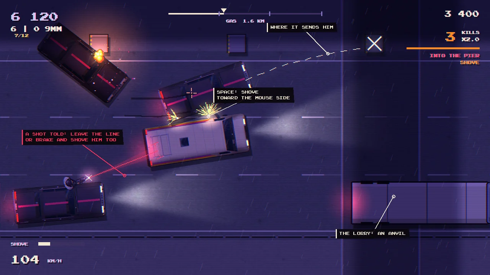

# LEVEL 2 - THE CHASE (2A) AND THE STATION (2B): level design and roadmap

This is THE reference for level 2. Read it before any level 2 work, keep to it, change it when a decision changes
(say so in the log), and add a line to the progress log at the end of every step (date, what was done, commit).
The concept boards are in docs/level2/ (painted by the concept pass of 2026-11-18, user-approved direction).

## Story and structure

- The night after level 1: the runner drives off in THE BOSS'S OWN CONVERTIBLE (level 1's ending page): bone body,
  blood-red seats, chrome, roof down, the boss's hat on the rear seat; the boss's men come after him. CUEBALL's matchbook points to the FLAMINGO MOTEL, where JITTERS hides: that is LEVEL 3, not level 2.
- Level 2 is two levels (the user's call, CLAUDE.md Gameplay): **2A, the chase** (about 2 min 30, from the bar's
  district to a big roadside gas station, ending on the convertible crashing through its first pump) and **2B, the station**
  (on foot: the car burning on the forecourt, the boss's men falling back into the store). Dying in 2A restarts the
  chase from 0:00; dying in 2B restarts 2B at the crash (he gets up off the ground, as level 1's opening).
- One hit kills still holds in the car: a shot told and not dodged into the open cabin, a nose-on hit on something
  that does not give, or being shoved off the road. Scrapes cost nothing (no health bar: his car is never shot up,
  burnt or blown); a corner clipped (what he hit covering under a fifth of his nose) is a jolt that takes his speed,
  not his life.

## 2A gameplay: proposal B, "shove and shoot" (chosen)

- **The car.** The boss's convertible, roof down: the runner is SEEN at the wheel (cap, collar, the coat's tails
  flapping out over the door), so one hit kills reads at a glance; about 2.1 t of land yacht with chrome bumpers
  for the shove. Boards painted before this choice still show a van.
- **Driving.** He steers freely; the road pulls the car along it (a spring toward the road's line and heading, so
  letting go straightens it). Forward / back: throttle / brake around a cruise speed set by the segment. It is a
  heavy car and feels it without costing the placing in a lane (one hit kills): the sideways speed answers as fast as
  ever, but the nose is on an under-damped spring (it turns in a little late, swings a little past, wags once), the
  rear steps out when the wheel is held hard at speed (smoke, rubber, the squeal), the last 15 km/h come slowly, and
  the body moves on its wheels (sat back under power, the nose down on the brakes and on a hit, rolled out of a
  bend, thrown up by a kerb, a hit, the road).
- **The shove (SPACE).** A hard sideways jolt of the car toward the mouse's side, with a cooldown (a bar on the
  HUD). It is a real Matter impulse: what the car hits is pushed into the scenery (piers, lorries, parked cars, the
  rail, gates). The wrecks come from the physics, not from scripts.
- **Shooting.** Mouse aim, one hand, from the open car (it faces +x; the driver sits on the -y side): ALL ROUND
  but behind him (the user's call, 2026-11-18): 125 degrees either side of the nose, 250 in all: out of his door,
  ahead OVER the low windscreen, across the passenger seat to his right (the gun goes over to his right hand, the
  left takes the wheel), back along both flanks; only the 110 degrees behind him stay out. The Uzi finishes what the
  shove started. Rounds are scarce: a killed gunman's gun or a magazine can fly into
  the car's lane as a pickup.
- **The gun: THE BOSS's Uzi, off his passenger seat** (the user's call, 2026-11-18). It lies on the convertible's
  passenger cushion (Vehicle `gun`; in level 1 too, seen as he vaults in and drives off, never a pickup there). 2A
  opens on a short beat, the first time only (a retry starts with it in hand, like level 1's bottle): the car rolls
  on by itself, the camera pushed in on him; his head turns to the seat, the right hand leaves the wheel and he leans
  over for it, brings it up across his chest, the left hand comes off the door and racks it, then it goes into the
  left hand and hangs out over the door, the right hand back on the wheel (about 1.7 s; systems/Drive.js grab,
  CharacterAnim grabPose, SEAT.grab in data/feel.js, SHOTS `grab` / `grabOut`). Nothing is told before it is done.
  Driving, the Uzi hangs over the door in his left hand; aimed out of his side that arm lifts it. 30 rounds in it and
  one spare magazine (`chase.arms`).
- **Killing a car.** Windscreen (the driver): it veers into the rail. A front tyre: it spins. The gunman: it goes on
  and can still ram. A hard enough shove into something solid: wrecked.
- **Telegraphs (readability first).** A gunman's shot: a white glint at the muzzle, then a thin red line that
  fattens into a wedge with a bracket where it lands (0.6 to 0.8 s), then the shot; the line locks onto a lane, not
  the car, so a lane change or a brake dodges it. One gunman tells at a time early on, two overlapping at the end.
  Obstacles about to enter the frame: red chevrons at the screen's edge. A safe gap: bone arrows. Nothing else red
  on the road.
- **Who is who.** The pursuers are the only black cars, with one pink stripe; civilians are pale or coloured.
  Enemy tracers bone, telegraph red, his own muzzle flash orange.
- **Slow motion** (from proposal C) only at three moments: the two jumps and the level crossing (time x0.25, weak
  points marked: a tyre, a tank, a driver).
- **Camera.** ONE view height a segment, whatever the speed (changed 2026-11-18: a zoom that followed the speed
  resampled the pixel art every frame, the car first: "le flou de la bagnole"): 360 world px on the back road (320 px
  from wall to wall: both rows of signs stay on the picture, the view drawn toward the street's middle, level
  `chase.mid`), to be 400 at 90, 440 at 120, 480 on the jump (level `chase.view`; the normal view is 290). The scene
  is drawn at the usual whole zoom on a larger canvas and the lens brings it down (Game.fit); no slow tilt at the
  wheel. The speed is told otherwise: the car sits further back the faster it goes (a third from the left at cruise,
  about a quarter flat out), the road rumbles over the cruise speed, the edges of the picture streak.
- **Speed.** What sells it (all of it only at the wheel, none of it over the car or the lanes): the lens' `speed.drive`
  (data/post.js: in the outer band of the picture the street's lights leave pixel trails along the road, streaks of
  air run back, the colours part, the band darkens and is stretched a little so it runs past faster; a shove or a hit
  kicks it), streaks of air in the world, dust off the rear wheels, paper and leaves whipped up in its wake, and a
  road that shows it goes by: the centre line and the parking row's edge line are DASHES (2 m and 3 m).
- Rejected as the main mechanic: A (lane-snap shooting: readable but on rails, seven rounds his only violence) and
  C (autopilot shooting gallery: throws the physics away). Boards: [A](level2/gameplay_a.webp),
  [B sheet](level2/gameplay_b_sheet.webp), [C](level2/gameplay_c.webp).

## 2A route (2 min 30, a tick every 15 s)

The level is built as a STRAIGHTENED strip: the road runs along +x on screen (as systems/Traffic.js lanes already
do); the route map's bends are only suggested by the scenery. (Turning the camera with the road is not planned.)

| # | Time | Segment | Speed, camera | What it is |
|---|------|---------|---------------|------------|
| 1 | 0:00-0:25 | THE BACK ROAD | 60 km/h, 380 px | 2 narrow lanes (2.5 m) and a row of parked cars; a block of shops, a dark stretch with a vacant lot, shops again, the lorry's yard and the cafe's terrace, the diner on the lit corner. Learns: steer, shove, shoot. One car, then one more at a time. Breaks: bins, hydrants, news boxes, benches, a phone booth, parked cars, the fence, a terrace. |
| 2 | 0:25-0:36 | THE ON-RAMP, THE TOLL | 90 km/h, 400 px | The road opens to 4 gates. Decides a gate 1.5 s out. They follow or die. |
| 3 | 0:36-1:10 | THE MOTORWAY | 120 km/h, 440 px | 4 lanes one way, traffic, lorries. Three of them at once. Piers, lorries and the rail are his weapons. The tanker at 0:58. |
| 3b | 1:10-1:25 | THE INTERCHANGE: A CHOICE | 110 km/h, 480 px | A: the unfinished flyover (needs 110 km/h at the plate, 1.5 s in the air, slow motion, one free round, one of them falls). B: the underpass (piers, a lorry coming; nothing lost, nothing won). |
| 4 | 1:25-2:03 | OFF THE ROAD: THE STORM DRAIN | 100 km/h | Through the site fence and down: concrete, a thread of water, banks he can ride, dumped things, piers. A helicopter light: in it their shots are told faster. Out by a ramp: the second jump. |
| 5 | 2:03-2:30 | THE LAST ROAD | 110 km/h | 2 lanes, traffic both ways. The level crossing. The last car. A tyre goes at 2:20: on the rim to the station. |

Events:

| # | Time | Event | What happens |
|---|------|-------|--------------|
| 1 | 0:08 | OUT OF THE ALLEY | One of theirs across his nose: its lamps first, a red lane. Brake, or shove it into the parked cars. |
| 2 | 0:20 | THE LORRY BACKING OUT | Told 0.9 s (its beeper and reversing lamps, red chevrons on the edge of the screen, a red lane, bone arrows on the way round), then it shuts the street in 1.4 s. Under its tail flat out, or up the kerb through a terrace: tables, chairs, parasols, planters, awnings. Whoever follows him into it dies there. |
| 3 | 0:30 | THE TOLL | Bone arrow: a wooden arm that flies. Red cross: steel. The one behind him takes the wrong one. |
| 4 | 0:46 | THEY MULTIPLY | Three cars, a gunman in each. Piers down the median, a lorry in the slow lane. |
| 5 | 0:58 | THE TANKER | It folds across three lanes, its petrol runs back down the road, the fire runs up it: 4 s. One gap. It goes up behind him. |
| 6 | 1:12 | FLYOVER OR UNDERPASS | The choice, told 3 s out by two signs: a bone arrow up, a bone arrow down. |
| 7 | 1:19 | THE JUMP | Cones and barriers fly. Time x0.25: a tyre, a tank, a driver marked. The slow one drops onto the motorway below. |
| 8 | 1:28 | THE BILLBOARD | Through the fence. Shoot its strut: it comes down across the way in, on whoever is behind. |
| 9 | 1:40 | THE DRAIN | Banks, water, carts and barrels. They come down the banks either side of him. |
| 10 | 1:52 | THE RAIL BRIDGE, THE LIGHT | Four piers in the bed, three ways through, told at the edge of the frame. A train over it. The helicopter light sweeps. |
| 11 | 2:03 | THE RAMP OUT | The second jump, through a chain fence, back onto a road. Slow again: one round. |
| 12 | 2:16 | THE LEVEL CROSSING | The barriers down, the train told by its lamp and a red band. Beat it: it cuts them off, or takes one. |
| 13 | 2:24 | THE TYRE | The last car: its gunman takes his rear tyre (always). On the rim, sparks, he steers the slide. |
| 14 | 2:30 | THE STATION | Through the first pump. END OF 2A. 2B opens on the car burning and him getting up. |

Segment boards: [1 back road](level2/s1_backroad.webp), [2 toll](level2/s2_toll.webp),
[3 tanker](level2/s5_tanker.webp), [3b jump](level2/s3_jump.webp), [4 drain](level2/s4_canal.webp),
[14 crash](level2/s6_crash.webp).

## 2B: the station

- 58 x 46 m. The forecourt: 9 islands, 18 pumps under one canopy (a roof that fades over him); pumps are cover that
  bursts: a hit pump pours, the petrol runs to the low side (the store); FireSpread runs it.
- THE NITE OWL store, a relay of the boss: his men fall back into it. Five gondolas head high (they hide, they do not
  stop a round; shoved, one takes the next like dominoes); a wall of lit drinks fridges (a round bursts one: glass,
  a wet floor, its light gone) with the cold room behind; the counter (till, cigarette rack, a shotgun under it); the
  office (desk, phone, a case of money, the fuse box: lights out, systems/Power.js; the last man holds the car keys);
  the storeroom (crates, kegs, gas bottles, a rifle on a shelf, the staff door); toilets.
- Ways in: the glass front under their guns (every pane a way in and a line of fire); the car wash tunnel (brushes
  turning, jets that hide him like the extinguisher powder); the staff door from the back lot (a man smoking at it);
  the roof (ladder at the back, a skylight over the aisles: he drops onto the tallest shelf); the workshop (a car on
  the lift to drop on a man, oil drums, a tyre iron, a pit).
- The back lot: a delivery tanker on the fill point (a petrol trail to it is a fuse: the big one, and the timer of
  the last minute); a cage of six gas bottles by the workshop (a second, smaller bang).
- 14 men: 6 in the house, 8 out of the cars. The way out: their boss car in the back lot (black, the pink stripe): he
  leaves in it as the tanks go; the road to the Flamingo (level 3).
- Boards: [opening, the restart point](level2/2b_opening.webp), [forecourt](level2/2b_forecourt.webp),
  [store](level2/2b_store.webp), [car wash and back lot](level2/2b_backlot.webp).

## Art

Comic paintings: [the jump](level2/art_jump.webp), [the tanker](level2/art_tanker.webp),
[the siege](level2/art_siege.webp), [the chase](level2/art_chase.webp), [the crash](level2/art_crash.webp),
[the station](level2/art_station.webp). Level 3 teasers: [the Flamingo](level2/l3_flamingo.webp),
[JITTERS](level2/l3_jitters.webp).

Sprites the boards painted that do not exist yet: the pursuers' black car with its pink stripe (a car / car2
variant), civilian car palettes, lorry cab with tank and box trailers, toll booth and gates, cones, barriers, piers,
the billboard, pumps, islands, canopy, store shelves, fridge wall, counter and cigarette rack, glass front, car wash
brushes.

## Architecture decisions

- **A long straightened level.** 2A is a level like the others (tools/build_level2a.py through levelkit), very long
  along x. The whole route is about 2.4 km (2400 tiles): rendering and every map-sized buffer must be CHUNKED (baked
  near the camera, dropped far from it); level 1's map is 42 x 38 tiles, a back road alone is about 420 x 24.
  Segments may become separate builders joined end to end.
- **Drive mode.** The player sits in the car (drawn at its `seat`, carried with it); the car is a DYNAMIC Matter body driven by
  forces (not Vehicle.driveTo, which teleports and collides with nothing), so the shove and every impact are real.
  Its logic is DOM-free with its numbers in data/ (a `CHASE` table), unit tested.
- **Pursuers.** Vehicles with an AI (follow, flank, ram) and a gunman who leans out and tells his shot; their kill
  rules (driver, tyre, gunman, impact).
- **Events.** A level-data schedule by distance along the road (x), not by time, so a slow driver meets them in the
  same places; each event a small DOM-free system.
- **Lab.** Every new mechanic gets its station (the shove, a pursuer, the telegraph, later the jump).

## Roadmap

Milestones in order; each ends merged into main with its tests, a QA or shot check and a line in the log.

- [x] **M1a - The back road, drivable.** Chunked rendering for long maps; tools/build_level2a.py with segment 1
  (the back road: 2 lanes, a parking row, kerbs, shopfronts, alleys, street furniture that breaks); drive mode
  (steer, throttle, brake, the road's pull), the shove, nose-on crash death, the camera's pull-out and lead; the
  level reachable with ?level=level2a; a lab station; placeholder end (reaching the road's end ends the level).
- [x] **M1b - The first pursuers.** The pursuers' car sprite; pursuer AI (follow, flank, ram); the gunman and his
  told shot (glint, red line, bracket); shooting out of the driver's window (arc, ammo, pickups); kill rules; event
  1 (out of the alley) and two cars by 0:25; HUD (speed, shove bar, distance).
- [x] **M1c - Back road polish.** Event 2 (the lorry backing out, the terrace); what breaks on the kerb; sounds as
  named placeholders; tuning in play; first playable demo of 2A's first 25 s.
- [ ] **M2 - The toll and the motorway.** On-ramp, toll gates, 4 lanes, traffic, lorries, piers, three pursuers, the
  tanker.
- [ ] **M3 - The interchange.** The choice, the flyover jump (airborne state, slow motion, weak points), the underpass.
- [ ] **M4 - The storm drain.** Off-road surfaces, banks, the billboard, the rail bridge, the helicopter light, the
  second jump.
- [ ] **M5 - The last road and the crash.** The level crossing, the forced tyre, the crash into the station, 2A's end.
- [ ] **M6 - 2B, the station.** The level from the plan, its new props and systems, the store, the finale.
- [ ] **M7 - Comic pages** for 2A / 2B (opening, ending), sounds, QA plans, balance.

## Progress log

- 2026-11-18: the user chose THE BOSS'S CONVERTIBLE over the van for level 1's getaway and 2A (he reads at the
  wheel; the boss's own car; renders in the convertible pass). Wording updated; the boards still show a van.
- 2026-11-18: concept pass done (gameplay proposals A/B/C, route, segment boards, 2B plan, paintings); the user
  chose B, the 2A / 2B split with 2B restarting at the crash, the Flamingo as level 3, and started M1 with the
  back road. This document written.
- 2026-11-18: M1a. Long maps drawn in chunks (render/Chunks.js: floor and walls baked near the view a strip a frame,
  blood and flesh made where they land; a usual level is one chunk, painted as before); tools/build_level2a.py with
  the back road (450 x 25 tiles, `?level=level2a`, the alley at col 138 kept clear for event 1); drive mode
  (systems/Drive.js, data/chase.js: cruise 60 km/h, W to 75, S to a stop, A / D across, the road's pull, the shove on
  SPACE, nose-on crash death, parked cars woken and shoved by the physics, bolted things torn off); the camera's
  pull-out with the speed and its lead; the HUD's speed and shove bar; lab station 19 DRIVE. Still map-sized: the
  liquid on the floor (systems/Liquids.js, render/LiquidArt.js), to window before the full route (M2).
- 2026-11-18: M1b. The pursuers' car (VEHICLES `pursuer`: the sedan in black, one pink stripe down its middle, its
  hood and door debris to match); systems/Pursuit.js: the pursuers driven like his car (keeping up to 12 px/step, the
  side slot alongside on his driver's side in the other lane, the behind slot, a look-ahead strip per lane: swerve or
  brake, a side swipe now and then; knocked by his shove, the physics alone 0.6 s; a hard contact on a wall, a pole
  or a car wrecks it: smoke, a chance of fire, an obstacle), its gunman and his told shot (white glint 0.15 s, red line
  into a wedge 0.6 s, a bracket on the lane band), one tell at a time, 2-3 s between two; kill rules (windscreen: the
  driver, it veers into what lines the road; front tyre: a spin; rear: it limps; gunman: no more tells; tank:
  Vehicle's fire), each man a kill for the scoring (tags DRIVER, BLOWOUT, GUNMAN, SHOVED, style WRECKED);
  systems/CarGun.js: his 1911 out of the car (left click, R, a magazine and a spare one set by the level's
  `chase.arms`), his arc the driver's side and ahead (~200 degrees, never across the car nor the open car's
  windscreen), his arm drawn out through `riding.aim` in THE BOSS's convertible; pickups (a killed gunman's gun or a
  magazine thrown onto the road ahead, half the time); event 1 by distance (`chase.events`: the alley car waiting
  lamps on, its red lane told 0.7 s before it is in his lane, set off at col 125 so the lane is on the picture) and a
  second car from behind at col 270 (alongside by about 0:20); HUD: the road left (a line and metres) and red
  chevrons at the edge for pursuers off the picture, the ammo as on foot; lab station 19: a pursuer parked in the north
  lane, its gunman telling now and then, harmlessly. Decisions made in play (this document changed): the bracket is a
  box on the lane band (his seat's y at the tell's start +-22 px, its x led by HIS speed over the tell +-40 px): a lane
  change or a brake (or a burst when slow) dodges it; a told shot kills only if it reaches his seat (an open car: across
  its cabin, Vehicle.crossesSeat; a closed one: a side window or the windscreen); a gunman tells only from his car
  straight on the road and out of his own window (never across it); his rounds carry the car's speed (a car alongside
  is hit where it is aimed at); the alley car rammed nose-on by him is shoved into the parked cars and wrecked (his
  doing: SHOVED), so ploughing on is a way through too, at the price of his speed. Played by script in the headless
  browser: braking for the red lane and each tell, the first 25 s are survived (7 tells dodged).
- 2026-11-18: M1c. THE BACK ROAD REBUILT NARROW (tools/build_level2a.py: 450 x 24 tiles; lanes 2.5 m, one parking
  row, the north sidewalk 1 m, the south one 2 m: 320 px from facade to facade, the view about 380 px high at 60 km/h,
  drawn 0.75 of the way to the lanes' middle, so the shopfronts and their neon are always on the picture) and in five
  parts: the shops (LIQUOR, BAR, VIDEO, WASH 24H), the dark stretch (a vacant lot behind a chain fence he can go
  through, blind walls, pipes, one lamp in two, flickering), shops again, the lorry's yard and the cafe's terrace, the
  diner on the lit corner and the cross street; pigeons in his lane, cats, people on the sidewalks and at the tables
  (they run from the car, or die under it), manholes, water in the gutter. EVENT 2 (systems/Lorries.js, prop `lorry`:
  a box lorry painted at FINE density, `lasting`: nose-on into it is the crash; `blind`: the pursuers never see it and
  wreck themselves on it): set off at col 303, told 0.9 s, then backing 5 m at 115 px/s: at 60 km/h without a move he
  takes its tail on the nose; flat out and hugging the kerb he is under it (75 km/h, 16 px to spare); else the terrace. THE KERB: a bolted thing is
  torn off at once (a sensor from the contact on: before, a torn bench still stopped the car dead while it fell apart),
  a loose light one (120 kg or less) is flung by hand ahead and aside (Drive.fling), the car drives over debris
  (a loose bit landing under it threw two tons sideways: Matter shares an overlap equally), an awning or a parasol it
  passes under comes down (prop `canopy`); nothing on the kerb holds it up, a hit costs 3 % of the speed once a step.
  FEEL (data/chase.js): accel 9, back to cruise 7 a second, tear 0.8 px/step, tyre smoke and rubber on the road at a
  shove, hard steering and the brakes, spray out of water, what is ahead frightened. PURSUERS: one at the alley,
  one from behind at cols 165 and 250 (19 m back, alongside 3 s later; brought back up behind the picture when a
  wreck holds one up), a last one out of the cross street at col 382; a tell every 1.6-2.4 s, none while something
  else is told nor in the 520 px before it (one thing told at a time on this road); their own swipe at him no longer
  counts as his shove; a windscreen cracked by a knock no longer counts as the driver shot. FIXES: the gunman leans out
  of the REAR door's window (a round for the driver, from alongside, no longer takes him too); the HUD's 9MM for the
  1911 is the game's shared pistol / uzi pool, on purpose: left; shot at the wheel he stays in his seat, slumped over
  it, and the car runs on, drifts and stops (before: the seat empty, his body left on the road under the car, the
  car stopped dead). THE END: past col 428 the car runs on, the picture
  goes black, TO BE CONTINUED / NEXT: THE TOLL (Game state `continued`), then the results. Sounds: lorryBeep,
  lorryBrake, awningRip, tyreSkid, waterSpray (placeholders). Lab station 21 LORRY. Decisions changed (above): the
  camera's height at 60 km/h, the corner clip, his car never damaged. Played by script in the headless browser:
  swerving half onto the kerb for each tell, shooting the drivers, through the terrace, the run is finished in about
  27 s with every car killed.
- 2026-11-18: THE UZI. The gun of 2A is now THE BOSS's Uzi lying on the convertible's passenger seat (Vehicle `gun`,
  drawn by the car with a contact shadow, over the cigar burn: the burn shows once it is taken; level 1's getaway shows
  it too, not a pickup). 2A opens on the grab, the first time only (Game: a retry calls Drive.skipGrab): 1.7 s, the
  car at cruise by itself, the controls, the shove and the trigger off, no event set off nor shot told meanwhile
  (Pursuit waits on Drive.grabbing), the HUD's weapon blank until it is in his hand; the camera pushed in (SHOTS
  `grab`, zoom 2.5 on the drive's own, drawn onto him) then back out (`grabOut`, 0.7 s); the rack heard (the recorded
  `rack`), the gun lifted off the seat a placeholder (`seatGun`). At rest the Uzi hangs from his left hand over the door (SEAT.hang);
  the arm comes out with it in 0.09 s (riding.up). `chase.arms`: the Uzi, 30 + one spare magazine (30). Played by
  script in the headless browser (god mode, straight down the road, flat out along the south kerb past the lorry,
  aiming at the nearest pursuer's windscreen): bursts of 3 / 4 / 5 rounds: 9 / 12 / 24 fired, 48-51 rounds left at
  the end (magazine pickups included), 3 or 4 of the 4 cars stopped; the trigger held whenever one is in reach: 30 fired, 30
  left; held all the way: dry 6.8 s in, before the first car. On the back road the rounds are not scarce yet. Lab
  station 22 GRAB (station 17's convertible: E at its door, the grab every time; out, the Uzi back on the seat).
- 2026-11-18: THE FEEL PASS (the user: the car blurred, no speed, the driving, the gun only to the left). THE BLUR:
  the camera's zoom followed the speed (345 to 392 px of view: 3.03 picture px a world px at 60 km/h, never whole)
  and the picture swayed: every sprite resampled unevenly, differently every frame. Now ONE view height at the wheel
  (CHASE.camera.view 360, level `chase.view`), the scene at the usual whole zoom on a larger canvas brought down by
  the lens (Game.fit / setView; eased in and out of the car in the lab), no sway, the car snapped dead straight when
  it is, its body offsets in half px. SPEED: data/post.js `speed.drive` (render/Lens.js, PostGL.js: the outer band
  only), Drive `wind` / dust / wake (CHASE.fx), the camera's lead growing past cruise and its rumble
  (CHASE.camera), dashed lines on the road (tools/build_level2a.py). DRIVING (data/chase.js): `over` 4 (75 km/h in
  0.55 s from cruise, was 0.25 s), the nose's spring (`yaw`), the slide (`slide`: 0.16 rad flat out), the body
  (`body`: squat / dive / roll / lift), the shove 8 px/step given back at 26 a second with a camera push, roll, bounce
  and smoke. THE GUN: CHASE.gun.cone, 125 degrees either side of the nose in the open car (CarGun.inCone; a closed car
  keeps its window's arc), the seat's aim pose with either hand (SEAT.aim swap / pass, Vehicle.carry `side` / `hand`).
  Decisions changed (above): the camera, the shooting arc. Lab station 19: THE BOSS's convertible in the north lane
  and three pursuers to shoot right, left and ahead. Played by script, stepped at 60 Hz in the headless browser: the
  road finished in 26.9 to 27.6 s at cruise (23.1 s flat out), under the lorry's tail flat out still through, a tell
  sat through still kills, drivers shot on either side and ahead (8 rounds, 4 kills).
- 2026-11-19: 2A in the campaign (systems/Progress.js `CAMPAIGN` = tutorial, level1, level2a): level 1's results lead
  through the hit list to 2A (its intro card LEVEL 2A, then the first-time grab); an old save with level 1 done opens
  2A on load; after 2A (TO BE CONTINUED, the results) the title, CONTINUE plays 2A. The hit list pins 2A and 2B under
  JITTERS (2B a greyed note taped SOON, not a level); JITTERS is crossed out only by his last level.
